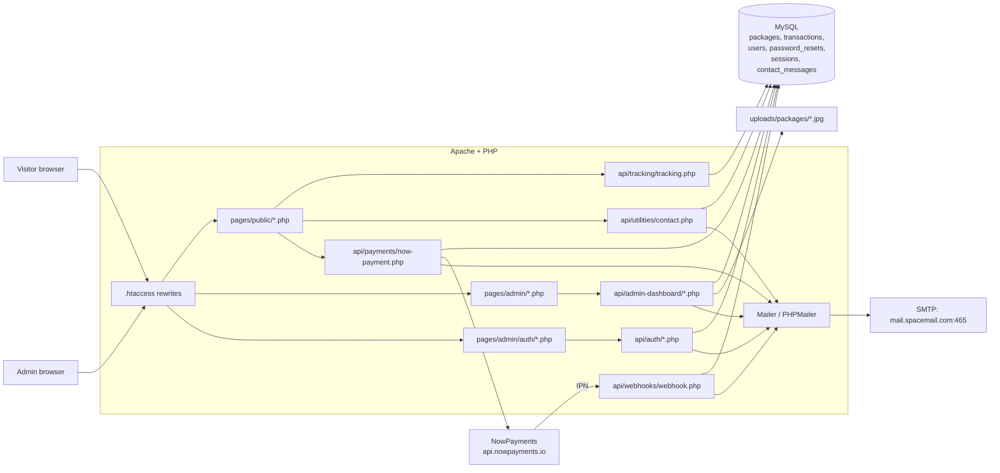
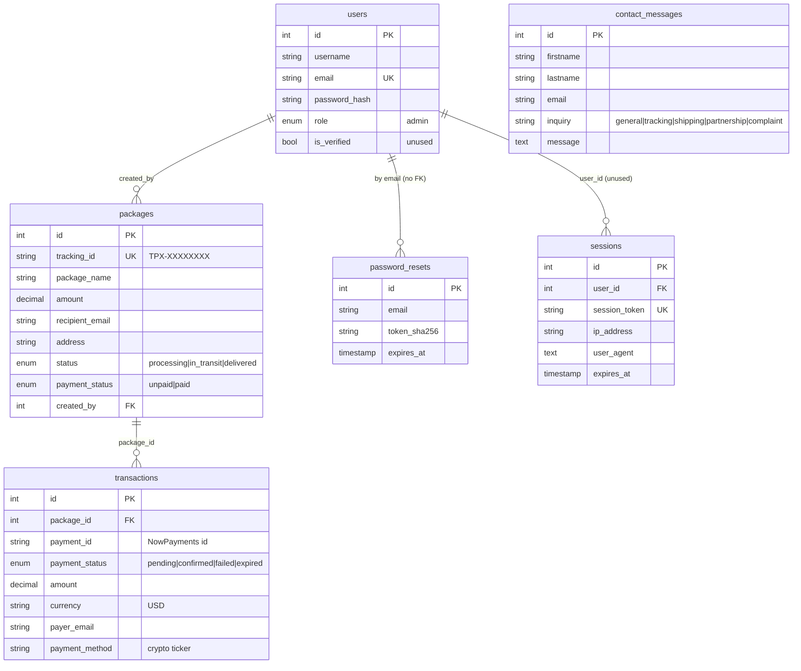
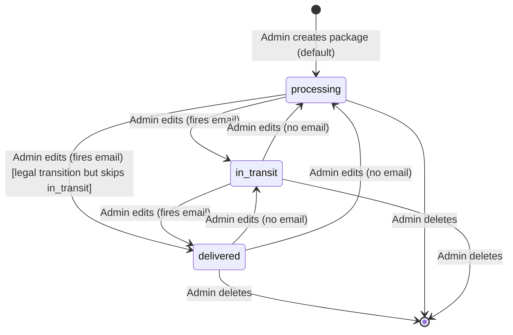
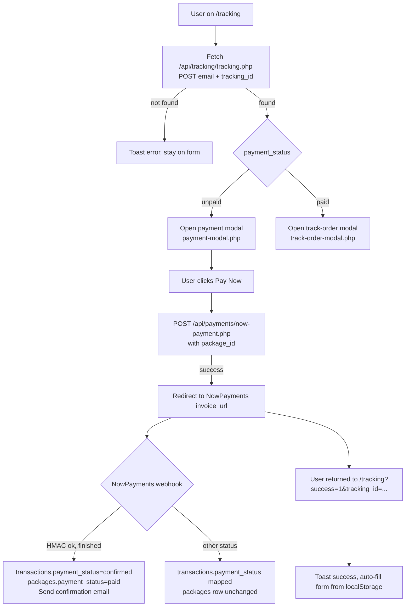

# Gotham Express — Platform Architecture

> **Naming note.** The product is being rebranded to **Gotham Express** (this
> document uses that name throughout). The current source still contains the
> previous name "TruePath Express" / `truepathexpress` in strings, URLs,
> comments, directory names, database name, tracking-ID prefix (`TPX-`) and
> email copy. Every reference to "Gotham Express" in this document maps to one
> of those legacy identifiers in the code — the port is the right time to
> replace them, and that work is called out in §14. Direct quotes from the
> code, file paths, config keys and SQL identifiers are kept verbatim because
> renaming them is out of scope for this read-only analysis.

Source commit at the time of writing: `efbf2980` on `main`.
Repository root: `/home/mrwayne/Documents/wayne/web_dev/gothamexpress`.

---

## 1. System Overview

Gotham Express is a single-tenant **consignment / parcel tracking** web app
built around one business pattern: a staff admin creates packages for named
recipients, each package gets a unique tracking ID, and the recipient visits
the public site, enters their email + tracking ID, and is either (a) prompted
to pay a crypto invoice via NowPayments (if the admin flagged the package
unpaid) or (b) shown the package status (if paid). There is no customer login,
no driver app, no dispatch workflow, no quotes/rates engine. "Shipment"
lifecycle is a three-state field (`processing → in_transit → delivered`) that
the admin flips manually.

### Audiences

| Audience | How they use the system |
|---|---|
| **Admin (staff)** | Logs into `/admin.auth.login`, creates/edits/deletes packages, flips status, sees transactions, logs out. One role only. |
| **Recipient (customer / guest)** | Visits `/tracking`, enters email + tracking ID, pays if required, views status in a modal. No account. |
| **General web visitor** | Browses marketing pages (home, about, services, policy, terms) and the contact form. |

There is **no driver, dispatcher, courier or multi-tenant role** in code. The
`users.role` column is `ENUM('admin')` with no other values defined
([dbschema/database.sql:15](dbschema/database.sql#L15)).

### Tech stack (versions where detectable)

| Layer | Technology | Version / notes |
|---|---|---|
| Language | PHP (procedural, no framework) | `>=7.4` required by [composer.json:5](composer.json#L5); SQL dump written on PHP 8.3.26 ([dbschema/truepathexpress.sql:7](dbschema/truepathexpress.sql#L7)) |
| Web server | Apache (`mod_rewrite`, `mod_deflate`, `mod_headers`) | Required by [.htaccess:1](/.htaccess#L1) |
| Database | MySQL 8.4.3 (per SQL dump header), InnoDB, `utf8mb4_0900_ai_ci` | [dbschema/truepathexpress.sql:8](dbschema/truepathexpress.sql#L8) |
| DB driver | PDO (`PDO::ERRMODE_EXCEPTION`, `ATTR_EMULATE_PREPARES=false`) | [config/database.php:17](config/database.php#L17) |
| Mail | PHPMailer `^7.0` over SMTP (TLS/SMTPS port 465) | [composer.json:6](composer.json#L6), [config/email.php:40](config/email.php#L40) |
| Payments | NowPayments REST API (`/v1/invoice`) + IPN webhook (HMAC-SHA512) | [api/payments/now-payment.php:91](api/payments/now-payment.php#L91), [api/webhooks/webhook.php:28](api/webhooks/webhook.php#L28) |
| Frontend | Vanilla JS (no framework, no bundler), hand-written CSS with design tokens | [assets/js/main.js](assets/js/main.js), [assets/css/main.css](assets/css/main.css) |
| Icon font | Phosphor Icons `2.1.1` via unpkg CDN | [includes/head.php:25](includes/head.php#L25) |
| Font | Local `Coolvetica` woff2 | [assets/css/main.css:9](assets/css/main.css#L9) |
| Build tooling | `sharp ^0.34.5` in `package.json` (image optimisation) — no scripts defined; no bundler, no transpile | [package.json](package.json) |
| Node | Only used for image prep. Prod runtime has no Node dependency. | **[Inferred]** |

Deploy hints: `envprod` has `APP_URL=https://truepathexpress.com` and
`APP_ENV=production`; `envlocal` targets `https://truepathexpress.test`
(a Laravel-Herd-style TLS host). The `.htaccess` rewrites imply a traditional
shared-hosting / cPanel-style deploy where the document root is the repo root.

### High-level component diagram



---

## 2. Directory Map

```
gothamexpress/
├── .htaccess                     Apache clean-URL rewrites + cache headers
├── index.php                     Delegates home-page to pages/public/index.php
├── .env / envlocal / envprod     Dot-env files (committed; see §12 Critical)
├── claude.md                     Original project brief / coding rules
├── composer.json / lock          PHP deps: PHPMailer 7.0
├── package.json                  JS deps: sharp (image optimisation)
├── folder-structure.txt          ~800 KB folder listing (not read by the app)
│
├── config/
│   ├── env.php                   Minimal .env parser (writes putenv + $_ENV)
│   ├── constants.php             APP_ROOT, APP_URL, APP_ENV, timezone, errors
│   ├── database.php              Singleton PDO Database class
│   └── email.php                 Mailer class wrapping PHPMailer SMTP
│
├── dbschema/
│   ├── database.sql              Clean DDL for the 6 tables (source of truth)
│   └── truepathexpress.sql       phpMyAdmin dump including seed users row + indexes
│
├── includes/
│   ├── head.php                  Public <head> incl. CSS/favicon/preloads
│   ├── header.php                Public <nav> markup
│   ├── footer.php                Public <footer> + main.js include + </html>
│   ├── sidebar.php               Admin layout: session guard + <head> + sidebar + opens <main>
│   ├── payment-modal.php         Reusable modal shown on /tracking when unpaid
│   └── track-order-modal.php     Reusable modal with status tracker + details
│
├── pages/
│   ├── public/
│   │   ├── index.php             Marketing home (hero, stats, services, CTA)
│   │   ├── about.php
│   │   ├── services.php
│   │   ├── tracking.php          Public tracking form; wires in both modals
│   │   ├── contact.php           Contact form
│   │   ├── policy.php
│   │   └── terms.php
│   └── admin/
│       ├── auth/
│       │   ├── admin-login.php            Full HTML + inline JS calling /api/auth/login.php
│       │   ├── admin-register.php         Public-reachable admin signup (see §12)
│       │   ├── admin-forgot-password.php  Sends reset email
│       │   └── admin-reset-password.php   Reads ?token=, posts to API
│       ├── dashboard.php         Stats cards + recent transactions
│       ├── packages.php          Packages table + create/edit modal (inline JS)
│       └── transactions.php      Transactions summary + table
│
├── api/
│   ├── auth/
│   │   ├── login.php             POST JSON, sets $_SESSION, sends login email
│   │   ├── register.php          POST JSON, creates admin, sends welcome email
│   │   ├── logout.php            session_destroy()
│   │   ├── forgot-password.php   Generates sha256-hashed token, 1-hour expiry
│   │   └── reset-password.php    Verifies token, updates password, deletes token
│   ├── admin-dashboard/
│   │   ├── dashboard.php         GET stats + recent 10 transactions
│   │   ├── packages.php          GET list / POST create|update / DELETE (multipart on write)
│   │   └── transactions.php      GET summary + full transactions join packages
│   ├── payments/
│   │   ├── now-payment.php       POST package_id → creates NowPayments invoice + transaction row
│   │   └── debug-payment.php     UNPROTECTED diagnostic endpoint (see §12)
│   ├── tracking/
│   │   └── tracking.php          POST {email, tracking_id} → package row
│   ├── webhooks/
│   │   └── webhook.php           NowPayments IPN; verifies HMAC-SHA512 signature
│   └── utilities/
│       ├── auth-check.php        requireAuth() — session gate for admin APIs
│       ├── tracking-id.php       generateTrackingId() → "TPX-" + 8 hex, uniqueness-checked
│       ├── image-upload.php      MIME + extension + size validation; moves file
│       ├── contact.php           POST JSON contact form; stores + emails user + admin
│       └── email_templates.php   12 getter functions returning full HTML emails
│
├── assets/
│   ├── css/
│   │   ├── main.css              1424 lines — design tokens + components (public)
│   │   ├── main.min.css          Empty file (0 bytes) — see §12
│   │   ├── responsive.css        396 lines — 4 breakpoints
│   │   ├── responsive.min.css    Empty file (0 bytes) — see §12
│   │   └── admin/styles.css      Admin console styles
│   ├── js/
│   │   ├── main.js               Loader, navbar, modals, toasts, animations
│   │   ├── payment.js            Tracking form → modal → NowPayments redirect
│   │   ├── contact.js            Contact form POST + toasts
│   │   └── admin/main.js         Admin sidebar, dropdown, logout, toast
│   ├── fonts/                    Coolvetica woff2 (regular + italic)
│   ├── favicon/                  Full favicon set
│   └── images/                   Section backgrounds + videos + logo
│
├── uploads/
│   └── packages/
│       ├── .htaccess             php_flag engine off + deny .php (good)
│       └── *.jpg                 Uploaded package images (not in gitignore for root uploads)
│
├── vendor/                       Composer-installed PHPMailer
└── node_modules/                 npm-installed sharp
```

---

## 3. Request Lifecycle (Frontend → Backend)

### 3.1 Entry points and rewrites

Everything hits Apache first. `.htaccess` rewrites fall into four groups:

| Pattern | Target | Lines |
|---|---|---|
| `^$` (root) | `pages/public/index.php` | [.htaccess:12](/.htaccess#L12) |
| `^admin\.auth\.(login\|register\|forgotpassword\|resetpassword)/?$` | `pages/admin/auth/admin-*.php` | [.htaccess:17-20](/.htaccess#L17) |
| `^admin\.(dashboard\|packages\|transactions)/?$` | `pages/admin/*.php` | [.htaccess:25-27](/.htaccess#L25) |
| Fallback `^([a-zA-Z0-9-]+)/?$` (file does not exist) | `pages/public/$1.php` | [.htaccess:32-34](/.htaccess#L32) |

Direct hits to `/api/...` are not rewritten — they resolve to the files on
disk. There is **no router script** for the API; each endpoint is a standalone
PHP file. `index.php` at the repo root simply `require`s
`pages/public/index.php` ([index.php:3](index.php#L3)).

### 3.2 Frontend routing

There is no SPA. Each public URL (`/tracking`, `/about`, …) resolves via the
fallback rewrite above to a `pages/public/<slug>.php` file, which is
server-rendered. Admin URLs use dotted slugs (`/admin.dashboard`,
`/admin.auth.login`) because the brief mandated minimal `.htaccess` rules; the
dots work around the "no slash in slug" fallback.

### 3.3 Fetch / AJAX conventions

The frontend calls the API with `window.fetch` using one of two bodies:

| Endpoint type | Body | Content-Type |
|---|---|---|
| Most APIs (login, tracking, contact, payment, forgot/reset, dashboard, transactions, delete package) | JSON | `application/json` |
| Package create/update | `FormData` | multipart (so image can be uploaded) |

All endpoints respond `application/json`. There are **two different response
shapes** in use (inconsistency flagged in §12):

```jsonc
// Shape A — most endpoints (login, tracking, admin APIs, payment, packages)
{ "success": true | false, "message": "...", /* extra top-level fields */ }

// Shape B — contact + forgot-password + reset-password
{ "status": "success" | "error", "message": "...", "data": { } }
```

HTTP status codes used: 200 (success), 400 (validation), 401 (unauthorised),
404 (not found), 405 (wrong method), 500 (server).

### 3.4 Walkthrough: a recipient tracks a package end-to-end

Taking the paid-package path (unpaid path is in §5.2):

1. Recipient clicks "Track Package" in the navbar
   ([includes/header.php:17](includes/header.php#L17)).
2. Apache rewrites `/tracking` → `pages/public/tracking.php` via the fallback
   rule.
3. `tracking.php` renders a form (email + tracking ID), includes
   `payment-modal.php` and `track-order-modal.php`, loads `/assets/js/payment.js`.
4. User submits. `payment.js` `handleTrackingSubmit()` does client-side
   validation (`uppercases` the tracking ID), then
   `fetch('/api/tracking/tracking.php', { POST JSON })`
   ([assets/js/payment.js:57](assets/js/payment.js#L57)).
5. `api/tracking/tracking.php` validates inputs, opens the DB via the
   `Database` singleton, runs `SELECT ... FROM packages WHERE tracking_id = ?
   AND email = ? LIMIT 1`
   ([api/tracking/tracking.php:40](api/tracking/tracking.php#L40)). The dual
   match (both tracking_id **and** email) is the only authorisation.
6. On a hit, the full package row (including sender/phone/address/image) is
   returned as JSON.
7. `payment.js` branches on `payment_status`:
   `'unpaid'` → `showPaymentModal()`, else `showTrackingModal()`
   ([assets/js/payment.js:76](assets/js/payment.js#L76)).
8. `showTrackingModal()` fills the DOM, calls `updateStatusTracker(status)`
   which lights up the Processing → Shipped → Delivered dots
   ([assets/js/payment.js:138](assets/js/payment.js#L138)), opens the modal.

Everything on this flow is synchronous. No sockets, no polling. If the
backend changes the status while the modal is open, the user must re-submit
the form to see it.

### 3.5 API inventory

All endpoints below; "Auth" = session cookie required.

| Method | Path (as the frontend calls it) | Handler file | Auth | Input | Output (success) | What it does |
|---|---|---|---|---|---|---|
| POST | `/api/auth/login.php` | [api/auth/login.php](api/auth/login.php) | — | JSON `{email,password}` | `{success,message}` + sets `$_SESSION` | Verifies credential, starts session, emails login alert |
| POST | `/api/auth/register.php` | [api/auth/register.php](api/auth/register.php) | — | JSON `{username,email,password}` | `{success,message}` | **Creates an admin** (no gating). Sends welcome email |
| GET  | `/api/auth/logout.php` | [api/auth/logout.php](api/auth/logout.php) | — | — | `{success,message}` | `session_destroy()` |
| POST | `/api/auth/forgot-password.php` | [api/auth/forgot-password.php](api/auth/forgot-password.php) | — | JSON `{email}` | `{status,message,data}` | Generates random 64-hex token, stores SHA-256 hash with 1h expiry, emails raw token link. Always returns the same message to avoid user enumeration |
| POST | `/api/auth/reset-password.php` | [api/auth/reset-password.php](api/auth/reset-password.php) | — | JSON `{token,password}` | `{status,message,data:{email}}` | Verifies hashed token, updates `users.password`, deletes used tokens, emails confirmation |
| GET  | `/api/admin-dashboard/dashboard.php` | [api/admin-dashboard/dashboard.php](api/admin-dashboard/dashboard.php) | Yes | — | `{success,stats,transactions}` | Package counts by status + 10 most recent transactions |
| GET  | `/api/admin-dashboard/packages.php` | [api/admin-dashboard/packages.php:66](api/admin-dashboard/packages.php#L66) | Yes | — | `{success,packages}` | All packages, `ORDER BY created_at DESC` |
| POST | `/api/admin-dashboard/packages.php` | [api/admin-dashboard/packages.php:79](api/admin-dashboard/packages.php#L79) | Yes | multipart (fields + optional `image`); `id` present = update | `{success,message}` | Create or update a package (unified endpoint). Emits status-change email on `in_transit`/`delivered` |
| DELETE | `/api/admin-dashboard/packages.php` | [api/admin-dashboard/packages.php:239](api/admin-dashboard/packages.php#L239) | Yes | JSON `{id}` | `{success,message}` | Deletes package row + its uploaded image (DB cascades transactions) |
| GET  | `/api/admin-dashboard/transactions.php` | [api/admin-dashboard/transactions.php](api/admin-dashboard/transactions.php) | Yes | — | `{success,summary,transactions}` | Summary of confirmed payments + all transactions LEFT JOIN packages |
| POST | `/api/payments/now-payment.php` | [api/payments/now-payment.php](api/payments/now-payment.php) | — | JSON `{package_id}` | `{success,payment_url,payment_id,message}` | Creates a NowPayments invoice, inserts `transactions` row, emails customer + admin |
| GET  | `/api/payments/debug-payment.php` | [api/payments/debug-payment.php](api/payments/debug-payment.php) | — | — | Diagnostic JSON incl. partial API key, DB status | **No auth** — leaks env state (§12) |
| POST | `/api/tracking/tracking.php` | [api/tracking/tracking.php](api/tracking/tracking.php) | — | JSON `{email, tracking_id}` | `{success,package}` | Public lookup; row returned only when `tracking_id AND email` match |
| POST | `/api/webhooks/webhook.php` | [api/webhooks/webhook.php](api/webhooks/webhook.php) | NowPayments HMAC | NowPayments IPN JSON + `x-nowpayments-sig` header | `{success}` or `{error}` | Verifies signature, updates `transactions.payment_status` + maybe `packages.payment_status = 'paid'`, emails confirmation |
| POST | `/api/utilities/contact.php` | [api/utilities/contact.php](api/utilities/contact.php) | — | JSON `{firstname,lastname,email,inquiry,message}` | `{success,message,data:{submission_id,confirmation_email_sent,admin_notified}}` | Stores contact row + emails user + admin |

**[Inferred]** The `api/utilities/*.php` files other than `contact.php`
(`auth-check.php`, `tracking-id.php`, `image-upload.php`,
`email_templates.php`) are include-only helpers and have no HTTP contract.
They are routable by URL via the fallback rewrite (requires a `.php`
extension), but nothing meaningful happens if hit directly except possibly
PHP errors; they are not part of the API surface.

---

## 4. Data Model

Schema source of truth: [dbschema/database.sql](dbschema/database.sql). The
phpMyAdmin dump [dbschema/truepathexpress.sql](dbschema/truepathexpress.sql)
is a drift snapshot — see §4.4.

### 4.1 Tables

#### `users`  — admin accounts
[dbschema/database.sql:12](dbschema/database.sql#L12)

| Column | Type | Notes |
|---|---|---|
| `id` | INT PK AUTO_INCREMENT | |
| `username` | VARCHAR(100) NOT NULL | |
| `email` | VARCHAR(255) UNIQUE NOT NULL | Login identifier |
| `password` | VARCHAR(255) NOT NULL | `password_hash(PASSWORD_DEFAULT)` — bcrypt by default |
| `role` | ENUM('admin') DEFAULT 'admin' | Only one role exists in the schema |
| `is_verified` | BOOLEAN DEFAULT FALSE | **Never read or written anywhere in the PHP code** (dead field). **[Inferred]** |
| `created_at`, `updated_at` | TIMESTAMPS | |

#### `password_resets` — single-use reset tokens
[dbschema/database.sql:25](dbschema/database.sql#L25)

| Column | Type | Notes |
|---|---|---|
| `id` | INT PK | |
| `email` | VARCHAR(255) NOT NULL | Index `idx_email` |
| `token` | VARCHAR(255) NOT NULL | **SHA-256 hex digest** of a 32-byte random token; raw token only goes out in the email ([api/auth/forgot-password.php:40](api/auth/forgot-password.php#L40)). Index `idx_token` |
| `created_at`, `expires_at` | TIMESTAMPS | Expiry is `NOW() + INTERVAL 1 HOUR` on insert |

#### `sessions` — unused
[dbschema/database.sql:38](dbschema/database.sql#L38)

Declared with `user_id`, `session_token`, `ip_address`, `user_agent`,
`expires_at`. **No PHP file writes to or reads from this table.** Login uses
native PHP `$_SESSION` only ([api/auth/login.php:35](api/auth/login.php#L35)).
Flagged as dead schema in §12.

#### `packages` — the core domain record
[dbschema/database.sql:52](dbschema/database.sql#L52)

| Column | Type | Notes |
|---|---|---|
| `id` | INT PK | |
| `tracking_id` | VARCHAR(50) UNIQUE NOT NULL | Format `TPX-XXXXXXXX` (see §5.2) |
| `package_name` | VARCHAR(255) NOT NULL | |
| `amount` | DECIMAL(12,2) NOT NULL | USD; used both as package price and as the invoice amount for NowPayments |
| `description` | TEXT NULL | |
| `invoice_message` | TEXT NULL | Shown on payment modal only |
| `sender` | VARCHAR(255) NOT NULL | Free-text sender name |
| `phone` | VARCHAR(50) NOT NULL | Recipient phone (not validated) |
| `firstname`, `lastname` | VARCHAR(100) NOT NULL | Recipient |
| `email` | VARCHAR(255) NOT NULL | Recipient email — doubles as the tracking authorisation key |
| `address` | VARCHAR(500) NOT NULL | |
| `location` | VARCHAR(255) NOT NULL | Free-text "City, Country" |
| `address_type` | VARCHAR(100) NOT NULL | Free-text "Residential / Commercial" (no enum) |
| `image` | VARCHAR(500) NULL | Web path, e.g. `/uploads/packages/2026-02-17_<hex>.jpg` |
| `status` | ENUM('processing','in_transit','delivered') DEFAULT 'processing' | |
| `payment_status` | ENUM('unpaid','paid') DEFAULT 'unpaid' | |
| `created_by` | INT NOT NULL FK → users(id) ON DELETE CASCADE | |
| `created_at`, `updated_at` | TIMESTAMPS | |

Indexes: unique `tracking_id`, non-unique on `email`, `status`,
`payment_status`.

#### `transactions` — one per NowPayments invoice attempt
[dbschema/database.sql:81](dbschema/database.sql#L81)

| Column | Type | Notes |
|---|---|---|
| `id` | INT PK | |
| `package_id` | INT NOT NULL FK → packages(id) ON DELETE CASCADE | |
| `payment_id` | VARCHAR(255) NULL | NowPayments invoice id, set when the invoice is created |
| `payment_status` | ENUM('pending','confirmed','failed','expired') DEFAULT 'pending' | |
| `amount` | DECIMAL(12,2) NOT NULL | Copied from packages at invoice time |
| `currency` | VARCHAR(10) DEFAULT 'USD' | Hard-coded 'USD' on insert |
| `payer_email` | VARCHAR(255) NOT NULL | Copied from `packages.email` |
| `payment_method` | VARCHAR(100) NULL | Filled from `pay_currency` in the IPN (crypto ticker) |
| `payment_url` | VARCHAR(500) NULL | NowPayments-hosted invoice URL |
| `created_at`, `updated_at` | TIMESTAMPS | |

Indexes: `payment_id`, `payer_email`, `payment_status`.

#### `contact_messages`
[dbschema/database.sql:101](dbschema/database.sql#L101)

`firstname`, `lastname`, `email`, `inquiry` (string, server-side whitelisted to
`general|tracking|shipping|partnership|complaint`), `message`, `created_at`.
No PK beyond `id`, no indexes beyond PK.

### 4.2 ER diagram



### 4.3 Enums and status vocabularies

| Enum | Values | Defined in | Also used by |
|---|---|---|---|
| `packages.status` | `processing`, `in_transit`, `delivered` | DB column | Validated in [api/admin-dashboard/packages.php:285](api/admin-dashboard/packages.php#L285), status-tracker UI in [assets/js/payment.js:149](assets/js/payment.js#L149), status-update email trigger in [api/admin-dashboard/packages.php:165](api/admin-dashboard/packages.php#L165) |
| `packages.payment_status` | `unpaid`, `paid` | DB column | Validated in [api/admin-dashboard/packages.php:291](api/admin-dashboard/packages.php#L291); branched on in [assets/js/payment.js:76](assets/js/payment.js#L76) and [api/payments/now-payment.php:50](api/payments/now-payment.php#L50) |
| `transactions.payment_status` | `pending`, `confirmed`, `failed`, `expired` | DB column | Mapped from NowPayments statuses in [api/webhooks/webhook.php:73](api/webhooks/webhook.php#L73) |
| NowPayments → ours map | `finished\|confirmed → confirmed`, `sending\|partially_paid\|waiting → pending`, `failed\|refunded → failed`, `expired → expired`, anything else → `pending` | [api/webhooks/webhook.php:73](api/webhooks/webhook.php#L73) | — |
| `contact.inquiry` | `general`, `tracking`, `shipping`, `partnership`, `complaint` | Validated in [api/utilities/contact.php:69](api/utilities/contact.php#L69); options in [pages/public/contact.php:102](pages/public/contact.php#L102) |
| Status-tracker UI step ids | `processing`, `shipped`, `delivered` | [assets/js/payment.js:139](assets/js/payment.js#L139), [includes/track-order-modal.php:19](includes/track-order-modal.php#L19) | **Note:** UI step id is `shipped`, DB value is `in_transit`. The JS maps `in_transit → shipped`; the mismatch is cosmetic but counts as drift. |

### 4.4 Schema drift

- The phpMyAdmin dump
  ([dbschema/truepathexpress.sql](dbschema/truepathexpress.sql)) adds `AUTO_INCREMENT` and the `ALTER TABLE ... ADD PRIMARY KEY` + `ADD KEY` statements that are not present in [dbschema/database.sql](dbschema/database.sql). The clean schema has the keys inline; both end up equivalent, but running the dump on an empty DB would attempt to add indexes that are implied inline in the DDL file. **[Inferred]** The two files are not kept in sync by any tool; the DDL is the hand-maintained source and the `.sql` dump is a one-time export.
- The dump embeds a seed admin row (`username=mrwayne`,
  `email=aleruchi0987@gmail.com`, bcrypt hash) and a seed contact message
  ([dbschema/truepathexpress.sql:134](dbschema/truepathexpress.sql#L134)). This
  is production-looking data in a committed file.
- `users.is_verified` exists in the schema and is seeded `0` but is **never
  referenced in PHP** — dead column.
- `sessions` table — dead table (see §4.1).

---

## 5. Domain Logic and Workflows

### 5.1 Package creation and lifecycle

Only an authenticated admin can create or move packages
([api/admin-dashboard/packages.php:21](api/admin-dashboard/packages.php#L21)
calls `requireAuth()`). Packages are created from the admin UI at
`/admin.packages` (modal in [pages/admin/packages.php:49](pages/admin/packages.php#L49)).

On create ([api/admin-dashboard/packages.php:206](api/admin-dashboard/packages.php#L206)):

1. Validate inputs (all recipient fields + enums); on failure return 400.
2. If an `image` file is in `$_FILES`, run it through `handleImageUpload()`
   ([api/utilities/image-upload.php:17](api/utilities/image-upload.php#L17)):
   checks `$_FILES` error, 5 MB cap, MIME via `finfo` (not just extension),
   extension whitelist, generates `YYYY-MM-DD_<16-hex>.<ext>`, `mkdir -p 0755`
   under `uploads/packages/`, `move_uploaded_file`.
3. Generate a unique tracking ID (next subsection).
4. Insert the row, pinning `created_by = $_SESSION['user_id']`.
5. No email is sent on initial creation.

On update ([api/admin-dashboard/packages.php:107](api/admin-dashboard/packages.php#L107)):

1. Validate; load existing row by `id` for its `image` and `status`.
2. Replace image if a new one was uploaded; delete the old image file.
3. Update all 15 scalar columns.
4. **If `status` changed to `in_transit` or `delivered`**, call
   `getPackageStatusUpdateEmail()` and send to the recipient
   ([api/admin-dashboard/packages.php:165](api/admin-dashboard/packages.php#L165)).
   No email on `processing`-to-anything-else-than-those-two (impossible given
   the enum), and no email on same-status re-save.
5. Email failure is swallowed (logged, update still succeeds).

Delete ([api/admin-dashboard/packages.php:239](api/admin-dashboard/packages.php#L239)):
loads image path, deletes file via `deleteImage()`, deletes the row — ON
DELETE CASCADE wipes related `transactions`.

**No soft-delete, no audit trail, no "assigned to" field.** No driver, no
dispatcher, no event log. The status transition is directly on the row —
history is lost on each save.



Note that backward transitions (`delivered → processing`) are legal in the
code — `validatePackageInput()` only checks the enum, not the direction.
**[Inferred]** This is unlikely to be intentional domain policy; see §15.

### 5.2 Tracking ID generation

[api/utilities/tracking-id.php](api/utilities/tracking-id.php). Format
`TPX-` + `strtoupper(bin2hex(random_bytes(4)))` → 8 uppercase hex characters,
e.g. `TPX-7A3F9B2C`. Up to 10 retries if a collision is seen in `packages`
([api/utilities/tracking-id.php:21](api/utilities/tracking-id.php#L21)); on 10
failures it throws. Space is 4,294,967,296 — collisions are negligible at
realistic volumes, so the retry loop is defensive rather than hot.

### 5.3 Public tracking flow (paid vs unpaid)



Important detail: the `payer_email` on the transaction is copied from
`packages.email` at invoice-creation time
([api/payments/now-payment.php:179](api/payments/now-payment.php#L179)), not
from the tracking form input. The two should match (the recipient had to type
their email to even see the Pay Now button), but there is no server-side
assertion of that match.

### 5.4 QR codes, labels, PDFs, receipts

**None.** No library imports `TCPDF`, `dompdf`, `endroid/qr-code`, etc.
(verified: `composer.json` lists only PHPMailer; a grep for `QR`/`qr_code`/
`pdf` returns no matches in code). Confirmation and status emails are plain
HTML. **No printable waybill or label is generated by the system.**

### 5.5 Driver / rider management

**Absent.** No table, no page, no API. The role enum has only `admin`.

### 5.6 Customer management

**Absent as a first-class entity.** "Customers" live only as denormalised
fields on `packages` (`firstname`, `lastname`, `email`, `phone`, `address`,
`location`). The same person shipping twice is two unrelated rows. There is
no customer login, no "my packages" list, no address book.

### 5.7 Pricing, rates, quotes, invoicing

- **No pricing engine, no rate card, no quote.** The admin types `amount` as
  a free-form USD figure on the package form.
- **"Invoicing"** means `packages.invoice_message` — a free-text string
  displayed on the payment modal. No invoice document, no numbering.
- Currency is hard-coded `USD` on insert into `transactions`
  ([api/payments/now-payment.php:170](api/payments/now-payment.php#L170)) and
  on the NowPayments request (`price_currency: 'usd'`,
  [api/payments/now-payment.php:84](api/payments/now-payment.php#L84)).

### 5.8 Payments and reconciliation

- Only provider: **NowPayments** (crypto payment gateway).
- Flow: see diagram in §5.3. Backend creates the invoice via
  `POST https://api.nowpayments.io/v1/invoice` with headers
  `x-api-key: $NOWPAYMENTS_API_KEY` + JSON body
  ([api/payments/now-payment.php:91](api/payments/now-payment.php#L91)). SSL
  verification is **disabled in development** and **enabled in production**
  ([api/payments/now-payment.php:97](api/payments/now-payment.php#L97)).
- Payment IDs are stored as returned (`transactions.payment_id`), the hosted
  URL in `transactions.payment_url`.
- Webhook: `POST /api/webhooks/webhook.php`. The IPN secret is used as the
  HMAC-SHA512 key over the raw body; the signature is compared with
  `$_SERVER['HTTP_X_NOWPAYMENTS_SIG']`
  ([api/webhooks/webhook.php:25](api/webhooks/webhook.php#L25)). On mismatch
  the request is rejected 401.
- **Idempotency**: already-confirmed `payment_id`s short-circuit with a 200
  "Already processed" response
  ([api/webhooks/webhook.php:94](api/webhooks/webhook.php#L94)).
- **Reconciliation**: none. There is no scheduled job that pulls payment
  status from NowPayments to catch missed webhooks. If an IPN is lost, the
  transaction row stays `pending` forever and `packages.payment_status` stays
  `unpaid`. An admin can manually flip the `payment_status` on the package in
  the admin UI, but this does not fix the transactions table.
- The `success_url` returns the user to `/tracking?success=1&tracking_id=...`
  — the client toasts success based purely on the query string, which is
  **not a trusted signal** of actual payment (anyone can forge it).
  payment_status in the DB is the source of truth.

### 5.9 Notifications

Email only — no SMS, no WhatsApp, no push, no in-app.

Transport: SMTP via `Mailer` ([config/email.php:17](config/email.php#L17)) →
`PHPMailer`. Default host `mail.spacemail.com:465` with SMTPS.

| Trigger | Template function | Called from | Recipient |
|---|---|---|---|
| Admin login succeeds | `getAdminLoginEmail($user, $time, $ip)` | [api/auth/login.php:44](api/auth/login.php#L44) | Admin's own email |
| Admin registration succeeds | `getAdminRegisterEmail($user, $email)` | [api/auth/register.php:45](api/auth/register.php#L45) | New admin |
| Forgot password requested (and account exists) | `getForgotPasswordEmail($user, $resetLink)` | [api/auth/forgot-password.php:63](api/auth/forgot-password.php#L63) | Admin |
| Password reset completed | `getResetPasswordConfirmationEmail($user)` | [api/auth/reset-password.php:99](api/auth/reset-password.php#L99) | Admin |
| Package status flipped to `in_transit` or `delivered` | `getPackageStatusUpdateEmail(...)` | [api/admin-dashboard/packages.php:174](api/admin-dashboard/packages.php#L174) | Recipient (`packages.email`) |
| Payment invoice created | `getPaymentInitiatedEmail(...)` | [api/payments/now-payment.php:211](api/payments/now-payment.php#L211) | Recipient |
| Payment invoice created (admin copy) | `getPaymentInitiatedAdminEmail(...)` | [api/payments/now-payment.php:230](api/payments/now-payment.php#L230) | `getenv('SMTP_FROM')` fallback `support@truepathexpress.com` |
| Payment confirmed | `getPaymentConfirmedEmail(...)` | [api/webhooks/webhook.php:148](api/webhooks/webhook.php#L148) | Payer |
| Payment confirmed (admin copy) | `getPaymentConfirmedAdminEmail(...)` | [api/webhooks/webhook.php:170](api/webhooks/webhook.php#L170) | `SMTP_FROM` |
| Contact form submitted | `getContactUserEmail(...)` + `getContactAdminEmail(...)` | [api/utilities/contact.php:131,160](api/utilities/contact.php#L131) | Sender + `SMTP_FROM` |

All templates share one branded wrapper
([api/utilities/email_templates.php:20](api/utilities/email_templates.php#L20)):
`#16232A` header bar, `/assets/images/logo/3.png` fetched from `APP_URL`
(so prod can embed it as an ``), `#E4EEF0` footer.

Every email send is wrapped in try/catch and logs on failure but **does not
block the business operation** — this is a deliberate pattern throughout the
code.

### 5.10 Reporting and dashboards

Admin dashboard shows only:
- Four stat cards: `total`, `delivered`, `in_transit`, `processing` package
  counts.
- Table of 10 most recent `transactions`.

Transactions page shows:
- Confirmed-payment total count and dollar sum.
- All `transactions` rows LEFT JOINed with `packages.tracking_id`.

No charts, no time-series, no filters, no exports.

---

## 6. Authentication, Roles and Permissions

### 6.1 Login and sessions

- **Password hashing**: `password_hash($p, PASSWORD_DEFAULT)` on both register
  ([api/auth/register.php:38](api/auth/register.php#L38)) and reset
  ([api/auth/reset-password.php:85](api/auth/reset-password.php#L85)).
  `password_verify()` on login
  ([api/auth/login.php:33](api/auth/login.php#L33)).
  `PASSWORD_HASH_COST` is in the env files (default 12) but is **not read**
  by any PHP file — the hash uses PHP's default cost. **[Inferred]**
- **Session store**: native PHP `$_SESSION`, cookie-based (whatever
  `session.save_handler` is set to at the server, default `files`). The DDL
  defines a `sessions` table that is unused in code (§4.1).
- Session keys set by login:
  `$_SESSION['user_id']`, `$_SESSION['email']`, `$_SESSION['role']`
  ([api/auth/login.php:35](api/auth/login.php#L35)).
- Logout: `session_destroy()`, no cookie clearing
  ([api/auth/logout.php:10](api/auth/logout.php#L10)).
- Session lifetime: `SESSION_LIFETIME=3600` in env, read in `constants.php`
  but never applied to `session_set_cookie_params` or `ini_set` — again
  effectively a dead config value.

### 6.2 Protected-route enforcement

Two gates exist:

- **Admin pages** (`pages/admin/*.php` other than `auth/`): include
  `includes/sidebar.php`, which at the top does `session_start()`; if
  `$_SESSION['user_id']` is missing it `header('Location: /admin/auth.login'); exit;`
  ([includes/sidebar.php:3](includes/sidebar.php#L3)). Note the redirect
  target `/admin/auth.login` is **not what the rewrite rules expose**
  (which is `/admin.auth.login` — dots, not slashes) — see §12.
- **Admin APIs** (`api/admin-dashboard/*.php`): include
  `api/utilities/auth-check.php` and call `requireAuth()`
  ([api/utilities/auth-check.php:17](api/utilities/auth-check.php#L17)) which
  returns 401 JSON if no session.

### 6.3 Permissions matrix

Only one role exists; a "guest" is anyone without a session.

| Capability | Guest | Admin |
|---|---|---|
| View public marketing pages (`/`, `/about`, `/services`, `/policy`, `/terms`) | ✔ | ✔ |
| Submit contact form (`POST /api/utilities/contact.php`) | ✔ | ✔ |
| Track package (`POST /api/tracking/tracking.php`) when they know `tracking_id` + `email` | ✔ | ✔ |
| Start NowPayments invoice (`POST /api/payments/now-payment.php`) | ✔ **(no gate; see §12)** | ✔ |
| Admin dashboard / packages / transactions pages | ✖ | ✔ |
| Create / update / delete packages | ✖ | ✔ |
| Register as admin (`POST /api/auth/register.php`) | ✔ **(no gate; see §12 — CRITICAL)** | ✔ |
| Trigger password reset for any email | ✔ (response is opaque) | ✔ |
| View debug payment info (`/api/payments/debug-payment.php`) | ✔ **(no gate; see §12)** | ✔ |

### 6.4 Endpoints that should be protected but are not

- `api/auth/register.php` — anyone with the URL can create an admin account.
  There is no "first-run" check, no invite flow, no setup token.
- `api/payments/now-payment.php` — gated only by having a valid
  `package_id`. The IDs are sequential integers, so an attacker could spam
  invoices for other recipients and pollute the `transactions` table.
  (Attacker cannot *pay* anyone else's package, but can noise the
  reconciliation view.)
- `api/payments/debug-payment.php` — leaks environment state.

See §12 for severities.

---

## 7. Integrations and External Services

| Service | Purpose | Files that call it | Config vars | Webhook / callback |
|---|---|---|---|---|
| **NowPayments** (`api.nowpayments.io`) | Crypto invoice creation + IPN | [api/payments/now-payment.php](api/payments/now-payment.php), [api/payments/debug-payment.php](api/payments/debug-payment.php) (status check), [api/webhooks/webhook.php](api/webhooks/webhook.php) | `NOWPAYMENTS_API_KEY`, `NOWPAYMENTS_PUBLIC_KEY` (declared but unread), `NOWPAYMENTS_IPN_SECRET` (all in `.env`/`envlocal`/`envprod`) | Inbound: `POST /api/webhooks/webhook.php`, HMAC-SHA512 header `X-Nowpayments-Sig` |
| **SMTP** (default `mail.spacemail.com`) | Transactional email | [config/email.php](config/email.php) used by all `Mailer`-sending files | `SMTP_HOST`, `SMTP_PORT`, `SMTP_USER`, `SMTP_PASS`, `SMTP_FROM`, `SMTP_FROM_NAME` | None (outbound only) |
| **Unsplash** CDN | Hero image on `/services` | [pages/public/services.php:6](pages/public/services.php#L6) | — | None |
| **unpkg** CDN | Phosphor Icons CSS | [includes/head.php:25](includes/head.php#L25), [pages/admin/auth/admin-login.php:11](pages/admin/auth/admin-login.php#L11), etc. | — | None |
| Google Fonts / Analytics / Maps | **Not integrated.** No API key present and no HTML embed. | — | — | — |

**`NOWPAYMENTS_PUBLIC_KEY`** is set in env but no PHP file reads it. **[Inferred]** It is scaffolded for front-end widget use that was never built.

---

## 8. Background Work

**None.** The repository contains:

- No cron entries, no `deployment/crontab.txt`, no `.cron` file.
- No queue (`jobs` / `failed_jobs` tables) and no worker script.
- No `supervisord`, `systemd` unit, or long-running PHP process.
- No scheduled polling of NowPayments (which, combined with the lack of IPN
  retry logic on our side, is the real reconciliation gap — see §5.8).
- Password-reset tokens are **not purged** when they expire; `expires_at`
  only blocks their use. Nothing cleans up `password_resets` rows other than
  the self-cleanup during the next forgot/reset for the same email.

The port target should pick these up — see §14.

---

## 9. Frontend Architecture

### 9.1 Page inventory

| Route | File | Purpose | Audience | API calls |
|---|---|---|---|---|
| `/` | [pages/public/index.php](pages/public/index.php) | Marketing home (hero, stats, services teaser, how-it-works, CTA) | Guest | — |
| `/about` | [pages/public/about.php](pages/public/about.php) | About page | Guest | — |
| `/services` | [pages/public/services.php](pages/public/services.php) | Services breakdown | Guest | — |
| `/tracking` | [pages/public/tracking.php](pages/public/tracking.php) | Tracking form; renders both modals | Guest | `/api/tracking/tracking.php`, `/api/payments/now-payment.php` (via Pay Now) |
| `/contact` | [pages/public/contact.php](pages/public/contact.php) | Contact form + info | Guest | `/api/utilities/contact.php` |
| `/policy` | [pages/public/policy.php](pages/public/policy.php) | Privacy policy copy | Guest | — |
| `/terms` | [pages/public/terms.php](pages/public/terms.php) | Terms of service copy | Guest | — |
| `/admin.auth.login` | [pages/admin/auth/admin-login.php](pages/admin/auth/admin-login.php) | Admin sign-in | Guest / Admin | `/api/auth/login.php` |
| `/admin.auth.register` | [pages/admin/auth/admin-register.php](pages/admin/auth/admin-register.php) | **Open admin signup** | Guest | `/api/auth/register.php` |
| `/admin.auth.forgotpassword` | [pages/admin/auth/admin-forgot-password.php](pages/admin/auth/admin-forgot-password.php) | Email form | Guest | `/api/auth/forgot-password.php` |
| `/admin.auth.resetpassword` | [pages/admin/auth/admin-reset-password.php](pages/admin/auth/admin-reset-password.php) | Reads `?token=`, sets new password | Guest with token | `/api/auth/reset-password.php` |
| `/admin.dashboard` | [pages/admin/dashboard.php](pages/admin/dashboard.php) | Stat cards + recent transactions | Admin | `/api/admin-dashboard/dashboard.php` |
| `/admin.packages` | [pages/admin/packages.php](pages/admin/packages.php) | CRUD table + modal | Admin | `/api/admin-dashboard/packages.php` (GET/POST/DELETE), `/api/auth/logout.php` |
| `/admin.transactions` | [pages/admin/transactions.php](pages/admin/transactions.php) | Transactions summary + list | Admin | `/api/admin-dashboard/transactions.php` |

### 9.2 JS organisation

- No modules, no bundler, no transpile. Four scripts loaded via `<script src="...">` tags with `defer`.
  - [assets/js/main.js](assets/js/main.js) — public-wide (loader, navbar scroll, mobile menu, testimonials carousel, scroll animations, global `openModal`/`closeModal`, `showToast`).
  - [assets/js/payment.js](assets/js/payment.js) — only loaded by `/tracking`. Fetches `/api/tracking/tracking.php`, decides which modal to show, drives the NowPayments redirect. Redefines its own `showToast`/`openModal` (duplication with `main.js`).
  - [assets/js/contact.js](assets/js/contact.js) — only loaded by `/contact`. Posts the contact form. Also redefines `showToast`.
  - [assets/js/admin/main.js](assets/js/admin/main.js) — only loaded on admin pages. Sidebar, user dropdown, logout, admin `adminToast`.
- Page-specific JS is **inlined in `<script>` blocks** on admin pages for
  dashboard rendering, packages list render + modal state, transactions
  render (search for `<script>` in each `pages/admin/*.php`).
- State: no store. Pages read from DOM and keep locals (e.g.
  `currentPackage` in [assets/js/payment.js:11](assets/js/payment.js#L11)).
  `localStorage` is used only to remember the recipient's email across the
  NowPayments redirect
  ([assets/js/payment.js:264](assets/js/payment.js#L264)).

### 9.3 Forms and validation

| Form | Client-side | Server-side | Match? |
|---|---|---|---|
| Admin login | `required` on inputs | `empty()` check on email + password | ✔ (both do presence) |
| Admin register | `required` + inline password-match (**[Inferred]** from form markup) | `empty()` on username/email/password; no length check | ✖ Server does **not** enforce password strength |
| Forgot / reset password | `required` + length cue in UI | 8-char min on reset ([api/auth/reset-password.php:28](api/auth/reset-password.php#L28)); 64-hex token format check | ✔ (basic) |
| Contact | 2-char min, email regex, 10-char min message ([assets/js/contact.js:32](assets/js/contact.js#L32)) | Mirrors client checks + 50/100/5000-char caps + inquiry whitelist ([api/utilities/contact.php:36](api/utilities/contact.php#L36)) | ✔ (server stricter) |
| Tracking | Email regex, `uppercase()` the ID | `FILTER_VALIDATE_EMAIL` + non-empty ID | ✔ (basic) |
| Package create/edit | `required` on inputs | `validatePackageInput()` requires 11 fields + enum whitelist for status/payment ([api/admin-dashboard/packages.php:273](api/admin-dashboard/packages.php#L273)) | ✖ Client HTML allows `.0001` amount; server only checks `is_numeric && > 0`. No max. No phone format check anywhere. No image is **not required** server-side on edit, even though the modal label says "Image *" |

### 9.4 Third-party frontend libraries

- Phosphor Icons `2.1.1` from `unpkg.com`.
- No React, no Vue, no jQuery, no bootstrap, no HTMX, no Alpine. The admin JS
  banner explicitly notes "Vanilla JS - No jQuery dependency"
  ([assets/js/admin/main.js:3](assets/js/admin/main.js#L3)).

---

## 10. Design System

### 10.1 Tokens (public site)

Defined on `:root` in [assets/css/main.css:30](assets/css/main.css#L30) and
summarised below.

**Colours.** The source uses the brand token names `mirage`, `blaze`,
`deep-sea`, `sand`, `crimson`, aliased to the semantic names below:

| Token | Value | Semantic alias |
|---|---|---|
| `--color-mirage` | `#16232A` | `--color-primary`, `--color-text` |
| `--color-blaze` | `#FF5B04` | `--color-accent` |
| `--color-deep-sea` | `#075056` | `--color-secondary` |
| `--color-sand` | `#E4EEF0` | `--color-bg-alt` |
| `--color-crimson` | `#92140C` | `--color-error` |
| `--color-success` | `#0A7A42` (hard-coded) | — |

Grey ramp: `--color-gray-100` `#F7F9FA` → `--color-gray-600` `#3A4E56`
(6 steps). `--color-white`, `--color-black`.

**Typography.** One family: `Coolvetica` (local woff2) with system fallback.
Scale from `--font-size-xs 0.75rem` through `--font-size-hero 4.5rem` (11
steps). Four line heights, four letter-spacings.

**Spacing.** 11-step scale: `--space-xs 0.25rem` → `--space-6xl 8rem`
([assets/css/main.css:82](assets/css/main.css#L82)).

**Radius.** 6 steps: `--radius-sm 4px` → `--radius-full 9999px`.

**Shadows.** 4 steps: `--shadow-sm` → `--shadow-xl` (mirage tints at
varying opacity).

**Transitions.** `--transition-fast 0.15s`, `--transition-base 0.3s`,
`--transition-slow 0.5s`, `--transition-smooth` cubic-bezier.

**Containers.** 5 steps: `--container-sm 640px` → `--container-max 1320px`.

Admin UI ([assets/css/admin/styles.css](assets/css/admin/styles.css)) uses
its own set of CSS variables and class names (`admin-sidebar`, `admin-main`,
`admin-table`, `stat-card accent-orange|green|teal|crimson`, `badge
badge-success|danger|info|default`) — see §10.5 for inconsistency.

### 10.2 Reusable components (public)

Noteworthy classes (full list in `main.css`):

| Component | Classes | Variants / modifiers |
|---|---|---|
| Buttons | `.btn` | `.btn--primary`, `.btn--secondary`, `.btn--outline`, `.btn--outline-light`, `.btn--lg`, `.btn--sm` |
| Nav | `.navbar`, `.navbar__inner`, `.navbar__menu`, `.navbar__link.active`, `.navbar__cta`, `.navbar__toggle` | Scrolled-state class via JS |
| Hero | `.hero`, `.hero--page`, `.hero__bg`, `.hero__overlay`, `.hero__content`, `.hero__label`, `.hero__title`, `.hero__desc`, `.hero__actions` | — |
| Cards | `.card`, `.card--bordered`, `.card__icon`, `.card__title`, `.card__text` | — |
| Grid | `.grid`, `.grid--2`, `.grid--3`, `.grid--4` | CSS grid |
| Stat row | `.stats-row`, `.stats-row__item`, `.stats-row__number`, `.stats-row__label` | Public, used on `/` and `/about` |
| Modal | `.modal-overlay`, `.modal`, `.modal__header`, `.modal__title`, `.modal__close`, `.modal__body`, `.modal__footer` | `.active` class to show |
| Form | `.form-group`, `.form-label`, `.form-input`, `.form-textarea`, `.form-select`, `.form-row` | — |
| Status tracker (3-step) | `.status-tracker`, `.status-tracker__step`, `.status-tracker__dot`, `.status-tracker__text` | `.active`, `.completed` set by JS |
| Package detail rows | `.package-detail`, `.package-detail__row`, `.package-detail__label`, `.package-detail__value`, `.package-detail__image` | — |
| Testimonials carousel | `.testimonials`, `.testimonials__track`, `.testimonials__slide`, `.testimonials__dot`, `.testimonials__btn` | **[Inferred]** Not currently rendered on any page I read, but the JS wiring in [assets/js/main.js:98](assets/js/main.js#L98) is defensive about absence |
| Toasts | `.toast-container`, `.toast`, `.toast--success`, `.toast--error`, `.toast--info` | Spawned by `showToast()` |
| Loader | `.loader`, `.loader__spinner` | `.hidden` toggles |
| Section | `.section`, `.section--alt`, `.section--dark`, `.section-label`, `.section-title`, `.section-desc`, `.section-header` | — |
| Split layout | `.split`, `.split--reverse`, `.split__image`, `.split__content` | — |
| Process | `.process-grid`, `.process-step`, `.process-step__number`, `.process-step__title`, `.process-step__text` | — |
| CTA band | `.cta` | — |
| Footer | `.footer`, `.footer__grid`, `.footer__brand`, `.footer__title`, `.footer__links`, `.footer__social`, `.footer__bottom`, `.footer__bottom-links` | — |
| Utilities | `.text-center`, `.text-accent`, `.text-white`, `.mb-0..2xl`, `.mt-xl..2xl`, `.hidden` | — |

### 10.3 Reusable components (admin)

Separate stylesheet, non-BEM naming:

| Component | Classes |
|---|---|
| Shell | `.admin-layout`, `.admin-sidebar`, `.admin-main`, `.admin-header`, `.admin-content` |
| Sidebar | `.sidebar-logo`, `.sidebar-nav`, `.sidebar-link`, `.sidebar-footer`, `.sidebar-logout` |
| Cards | `.card`, `.card-header`, `.card-body`, `.card-title` — **collides with the public `.card`** |
| Stat tile | `.stat-card`, `.stat-icon`, `.stat-value`, `.stat-label` + accent/icon colour classes `accent-orange\|green\|teal\|crimson`, `icon-orange\|green\|teal\|crimson` |
| Table | `.admin-table`, `.table-wrap`, `.table-empty`, `.table-tracking-id` |
| Badge | `.badge`, `.badge-success`, `.badge-danger`, `.badge-info`, `.badge-default` |
| Modal | `.modal-overlay`, `.modal-box`, `.modal-header`, `.modal-close`, `.modal-title`, `.modal-body`, `.modal-footer` (classes without `__`, unlike public modal) |
| Form | `.form-control` (admin) vs `.form-input` (public) |
| Buttons | `.btn btn-primary\|secondary\|outline\|link\|ghost btn-lg\|full`, `.btn-icon`, `.action-btns` |
| Grid | `.row`, `.col-3`, `.col-4`, `.col-6`, `.col-8` (12-col-ish inline system) |
| Toast | `.toast.success`, `.toast.error`, `.toast.info` + `window.adminToast` (different from public `showToast`) |

### 10.4 Layout, breakpoints, mobile

[assets/css/responsive.css](assets/css/responsive.css) has exactly four
breakpoints:

| Breakpoint | What changes |
|---|---|
| `≤ 1200px` | Container tightens, hero typography scales down |
| `≤ 992px` | Grid stacks, hero typography further down |
| `≤ 768px` | Mobile menu, modals slide up from bottom (`transform: translateY(100%)` → `0` as per project rule), stat-rows collapse |
| `≤ 576px` | Smallest-screen tweaks (padding, button sizes) |

Modals obey the "slide up from bottom" rule
([.htaccess-rule brief, `claude.md`](claude.md#L89)): the mobile styles pin
`.modal` to the viewport bottom with `transform` animation. **[Inferred]** —
the responsive stylesheet is what implements the mobile rule but was not
re-read line-by-line here.

### 10.5 Icons, imagery, animations, light/dark

- **Icons**: Phosphor "bold" face only (`ph-bold ph-*`).
- **Imagery**: section backgrounds served as `.webp` with 480w/800w/1200w
  srcset and `.png` fallbacks ([assets/images/sections/](assets/images/sections/)).
  Two `.mp4` videos (`animation.mp4`, `movingcontainers.mp4`) referenced in
  `services.php` and (**[Inferred]**) the home page.
- **Animations**: subtle entrance via `IntersectionObserver` on `.card`,
  `.split__*`, `.process-step`, `.stats-row__item`, `.contact-info__item`
  ([assets/js/main.js:180](assets/js/main.js#L180)). Loader spinner on page
  load. Testimonials carousel autoplay (5 s).
- **Light/dark mode**: **not implemented.** No `prefers-color-scheme`
  rules, no theme toggle.

### 10.6 Inconsistencies

- **Two component systems with colliding class names.** Both the public and
  admin stylesheets define `.card`, `.modal-overlay`, `.btn`, `.form-row`.
  They happen not to collide at runtime because admin pages only load
  `/assets/css/admin/styles.css` and auth pages load `/assets/css/main.css`.
  But admin **auth** pages (`admin-login.php` etc.) link `main.css`
  ([pages/admin/auth/admin-login.php:14](pages/admin/auth/admin-login.php#L14))
  and then redefine ~250 lines of auth-specific CSS inline — i.e. a third
  partial system.
- Toast is implemented **three times**: `showToast` in
  [assets/js/main.js:168](assets/js/main.js#L168), another `showToast` in
  [assets/js/payment.js:245](assets/js/payment.js#L245), another `showToast`
  in [assets/js/contact.js:116](assets/js/contact.js#L116), plus
  `adminToast` in [assets/js/admin/main.js:84](assets/js/admin/main.js#L84).
  They render slightly different markup and read different container ids.
- `openModal`/`closeModal` is defined **twice** —
  [assets/js/main.js:144](assets/js/main.js#L144) and
  [assets/js/payment.js:380](assets/js/payment.js#L380) — with different
  animation behaviour.
- Status label mismatch: UI step "Shipped" vs DB value `in_transit` (§4.3).
- Admin forms use `.form-control`; public forms use `.form-input`.

---

## 11. Configuration and Environment

### 11.1 Config files

| File | Purpose |
|---|---|
| [.env](/.env) | **Committed.** Active env values at runtime. Contains SMTP password, NowPayments API key, IPN secret. |
| [envlocal](envlocal) | **Committed.** Development profile (`APP_URL=https://truepathexpress.test`, `APP_ENV=development`). |
| [envprod](envprod) | **Committed.** Production profile (`APP_URL=https://truepathexpress.com`, `APP_ENV=production`). |
| [.gitignore](/.gitignore) | Lists `.env` — but `.env` is nonetheless present in the tree (git-tracked historically). `envlocal`/`envprod` are not ignored. |
| [config/env.php](config/env.php) | Minimal parser that reads `.env` only (not `envlocal`/`envprod`); writes via `putenv` + `$_ENV`. |
| [config/constants.php](config/constants.php) | Defines `APP_ROOT`, `APP_URL`, `APP_ENV`, `APP_NAME`, path constants, timezone, error reporting. |
| [config/database.php](config/database.php) | Singleton `Database` → PDO MySQL connection, utf8mb4. Fails fast; shows message in dev, generic in prod. |
| [config/email.php](config/email.php) | `Mailer` wrapper around PHPMailer SMTPS. |
| [.vscode/settings.json](.vscode/settings.json) | IDE preference only. |
| [.claude/settings.local.json](.claude/settings.local.json) | Claude Code harness settings (not read by the app). |

### 11.2 Environment variables

| Variable | Read in | Controls |
|---|---|---|
| `DB_HOST`, `DB_PORT`, `DB_NAME`, `DB_USER`, `DB_PASS` | [config/database.php:13](config/database.php#L13) | MySQL connection |
| `APP_NAME` | [config/constants.php:22](config/constants.php#L22) | Branding in emails, mail "from name" fallback |
| `APP_URL` | [config/constants.php:23](config/constants.php#L23) | Used as base for NowPayments callback URLs, reset links, email logo src |
| `APP_ENV` | [config/constants.php:24](config/constants.php#L24) | Flips error reporting on; disables cURL SSL verification for NowPayments in `development` |
| `SESSION_LIFETIME` | [config/constants.php:27](config/constants.php#L27) | **Defined but never applied** to the session cookie or `session.gc_maxlifetime` |
| `PASSWORD_HASH_COST` | **Not read anywhere.** [envprod](envprod) sets `12` but `password_hash(PASSWORD_DEFAULT)` is used with PHP defaults | — |
| `SMTP_HOST`, `SMTP_PORT`, `SMTP_USER`, `SMTP_PASS`, `SMTP_FROM`, `SMTP_FROM_NAME` | [config/email.php:19](config/email.php#L19) | SMTP connection + envelope |
| `NOWPAYMENTS_API_KEY` | [api/payments/now-payment.php:65](api/payments/now-payment.php#L65) | Outbound auth to NowPayments |
| `NOWPAYMENTS_IPN_SECRET` | [api/payments/now-payment.php:66](api/payments/now-payment.php#L66), [api/webhooks/webhook.php:19](api/webhooks/webhook.php#L19) | HMAC for IPN |
| `NOWPAYMENTS_PUBLIC_KEY` | **Not read anywhere.** | — |

### 11.3 Local vs production differences

- `APP_ENV=development` disables PDO error display suppression, prints
  "Database connection failed: …" with details on connect failure, and
  disables cURL SSL peer verification against NowPayments.
- `APP_URL` is the only other active difference; everything else in
  `envlocal` vs `envprod` is cosmetically identical.
- There is **no automated switching mechanism** between `envlocal` and
  `envprod` — the parser only reads `.env`. Operators are expected to
  overwrite `.env` with the chosen profile at deploy time. **[Inferred]**
  Nothing in the repo automates that.

---

## 12. Security and Quality Assessment

Severity: **Critical** = direct account/data takeover or large data exposure.
**High** = significant risk requiring an attacker action but no privileged
access. **Medium** = policy / defence-in-depth issue. **Low** = hygiene.

### Critical

1. **Open admin registration.**
   [api/auth/register.php:1-58](api/auth/register.php) accepts a public
   `POST` and inserts a row into `users` with `role='admin'` (DB default). No
   session gate, no invite token, no CAPTCHA, no rate limit, no first-run
   check. The `/admin.auth.register` route is also publicly linked from the
   login page's "Register" link. Anyone on the internet can create an admin.
   → **Fix on port**: close registration, use CLI/seeder for the first
   admin, use a Policy/invite flow after that.

2. **Secrets committed to the repository.** `.env`, `envlocal`, `envprod` are
   all tracked. They contain the live NowPayments API key, IPN secret, and
   SMTP password (same credentials repeated in [claude.md](claude.md) in
   plaintext — doubly leaked). Even the git history after rotation remains
   exposed. → **Fix on port**: rotate NowPayments key, SMTP password; move
   secrets to a non-committed `.env`; remove plaintext credentials from
   [claude.md](claude.md).

3. **Debug endpoint publicly reachable.**
   [api/payments/debug-payment.php](api/payments/debug-payment.php) is a
   diagnostic that returns the DB connection status, the first 8 characters
   of the live NowPayments key, PHP version, extension list, and whether the
   `.env` is readable. No auth. Observable at `/api/payments/debug-payment.php`.
   → **Fix on port**: delete or gate behind admin middleware.

### High

4. **No CSRF protection on admin-authenticated endpoints.** The admin APIs
   (`api/admin-dashboard/packages.php`, `transactions.php`, `dashboard.php`)
   trust the session cookie only. There is no CSRF token in the admin forms,
   no `SameSite=strict` cookie setting, no `Origin`/`Referer` check. An
   attacker who gets an admin to visit a hostile page can delete or alter
   packages. → **Fix on port**: Laravel CSRF middleware covers this
   automatically.

5. **Weak password policy.** Register and login have no server-side minimum
   length / complexity (the empty-string check is the only gate at
   [api/auth/register.php:19](api/auth/register.php#L19)). Reset flow does
   require 8 chars ([api/auth/reset-password.php:28](api/auth/reset-password.php#L28)),
   but a weaker password can still be set via register. Also,
   `PASSWORD_HASH_COST=12` in env is ignored (§6.1).

6. **Payment-initiation endpoint is unauthenticated.**
   [api/payments/now-payment.php](api/payments/now-payment.php) only
   requires a valid integer `package_id`. An attacker can enumerate IDs and
   generate NowPayments invoices in bulk, filling `transactions` with
   `pending` rows and triggering invoice emails to real recipients and to
   the admin. → **Fix on port**: require the recipient's email to match the
   package (same check as tracking), or require a short-lived token issued
   by the tracking endpoint.

7. **No webhook replay / tolerance window.**
   [api/webhooks/webhook.php](api/webhooks/webhook.php) does HMAC
   verification well, but it does not check a timestamp, so a captured
   webhook body + header can be replayed indefinitely. The idempotency
   check prevents duplicate confirmed-status flips, but a replayed
   `failed`/`expired` body for a payment that is still `pending` would
   trigger a status change. Low likelihood but worth noting.

8. **Signature comparison is `!==`, not timing-safe.** Same file, line 32.
   Use `hash_equals()`.

### Medium

9. **Email enumeration is partially mitigated but inconsistent.**
   `forgot-password.php` deliberately returns the same message whether or
   not the email matches
   ([api/auth/forgot-password.php:70](api/auth/forgot-password.php#L70)) —
   good. But `register.php` responds with "Email already registered" and
   `login.php` responds with "Invalid credentials" — a precise email-exists
   oracle via register.

10. **Admin redirect target is wrong.**
    [includes/sidebar.php:4](includes/sidebar.php#L4) sends unauthenticated
    users to `/admin/auth.login`, but the rewrite in
    [.htaccess:17](/.htaccess#L17) exposes the login as `/admin.auth.login`.
    The result is a 404-via-fallback-rewrite to
    `pages/public/admin/auth.login.php` which does not exist. → Low impact
    (the user can self-correct), but it breaks guest access to the admin.

11. **Session cookie flags not set.** No `session.cookie_secure`,
    `cookie_httponly`, `cookie_samesite` tuned in code. Relies entirely on
    `php.ini` defaults. Combined with #4, this is how CSRF stays dangerous.

12. **Email sends in-process on every request path.** Login, register,
    forgot/reset, package status change, payment init, webhook all do
    synchronous SMTP sends in the request thread. A slow SMTP provider will
    hang the user's HTTP request. There is no queue. → §8.

13. **No input sanitisation on display paths.** The admin JS writes
    package data straight into the DOM via `innerHTML +=` concatenation,
    e.g.
    [pages/admin/packages.php:231](pages/admin/packages.php#L231) builds the
    row from `p.package_name`, `p.firstname`, etc. with no escaping. A
    recipient-provided-via-admin field containing `` would
    execute in the admin's browser (stored-XSS). The attacker here is the
    admin themselves, but any multi-admin future makes this real.

14. **`uploads/.htaccess` protects `uploads/packages/` only.** The nested
    `uploads/packages/.htaccess` disables PHP execution and denies `.php`
    — great. But if the `handleImageUpload()` helper is called with
    `$uploadDir = 'something-else'`, that sibling directory would have no
    `.htaccess` and could execute PHP. Current call sites pass only
    `'packages'` ([api/admin-dashboard/packages.php:127](api/admin-dashboard/packages.php#L127)),
    so this is latent, not active.

15. **`.htaccess` fallback can serve arbitrary `pages/public/*.php`.** The
    rule
    `RewriteRule ^([a-zA-Z0-9-]+)/?$ pages/public/$1.php [L]`
    will route `/head`, `/footer`, `/payment-modal` etc. to any PHP file
    under `pages/public/` with a matching name — currently none that are
    private, but partial-render files added later would be publicly
    reachable.

### Low

16. **Dead code / dead schema.** `sessions` table, `users.is_verified` field,
    `NOWPAYMENTS_PUBLIC_KEY`, `PASSWORD_HASH_COST`, `SESSION_LIFETIME`,
    `assets/images/placeholder-package.jpg` (referenced in `payment.js` but
    not present on disk — a 404 is served when a package has no image), plus
    the empty `main.min.css` / `responsive.min.css` files that
    [includes/head.php:34-35](includes/head.php#L34) link to (meaning the
    public site currently serves **zero bytes of CSS**).

17. **CSS inline-style policy violation.** The project rules in
    [claude.md:63](claude.md#L63) forbid inline styles; the admin pages
    use them liberally (e.g.
    [includes/payment-modal.php:35](includes/payment-modal.php#L35)).

18. **Confirm dialog in admin UI.** `confirm('Are you sure…')` in
    [pages/admin/packages.php:254](pages/admin/packages.php#L254) — browser
    modal, blocks event loop; already noted as a port-specific annoyance.

19. **N+1 risk is low** because the dataset is small-table-ful; the
    transactions page LEFT JOINs `packages` in a single query
    ([api/admin-dashboard/transactions.php:51](api/admin-dashboard/transactions.php#L51)).
    No lazy-load N+1 was spotted.

20. **No indexes on `contact_messages`** beyond PK — fine today, but if
    this ever supports search by email it will scan.

### Tech debt observations

- **Duplicated front-end helpers**: `showToast`/`openModal` repeated across
  `main.js`, `payment.js`, `contact.js` (§10.6).
- **Response-shape inconsistency**: `success`/`message` vs
  `status`/`message`/`data` (§3.3) — the frontend reads both forms, so a
  rename would need both ends.
- **Mixed layout engines**: public BEM-ish classes vs admin
  flat-dash classes (§10.5).
- **Error reporting**: dev mode `die()`s with the raw PDO error
  ([config/database.php:28](config/database.php#L28)) — fine locally; in
  production the suppression relies on APP_ENV being set correctly.

---

## 13. Feature Inventory

| Feature | Roles | Key files | Status | Notes |
|---|---|---|---|---|
| Marketing site (home, about, services, policy, terms) | Guest | [pages/public/*.php](pages/public/) | Working | Static copy with hero + sections. Testimonials carousel JS exists but no visible markup renders it (**[Inferred]**). |
| Contact form (store + email user + email admin) | Guest | [pages/public/contact.php](pages/public/contact.php), [api/utilities/contact.php](api/utilities/contact.php) | Working | DB row + two emails per submit. |
| Public package tracking | Guest | [pages/public/tracking.php](pages/public/tracking.php), [api/tracking/tracking.php](api/tracking/tracking.php) | Working | Email + tracking_id dual match. |
| Payment-required gating in tracking modal | Guest | [assets/js/payment.js](assets/js/payment.js), [includes/payment-modal.php](includes/payment-modal.php) | Working | Shows payment modal when `payment_status='unpaid'`. |
| NowPayments crypto invoice creation | Guest | [api/payments/now-payment.php](api/payments/now-payment.php) | Working | Open to any guest with a package_id (see §12 #6). |
| NowPayments IPN webhook (signature-verified) | NowPayments | [api/webhooks/webhook.php](api/webhooks/webhook.php) | Working | Idempotent on confirmed. No reconciliation job if webhook is lost. |
| Admin login / sessions | Admin, Guest | [pages/admin/auth/admin-login.php](pages/admin/auth/admin-login.php), [api/auth/login.php](api/auth/login.php) | Working | Sends security email on each login. |
| Admin registration | Guest | [pages/admin/auth/admin-register.php](pages/admin/auth/admin-register.php), [api/auth/register.php](api/auth/register.php) | **Working but should be removed in prod** | See §12 #1. |
| Forgot / reset password | Admin, Guest | [api/auth/forgot-password.php](api/auth/forgot-password.php), [api/auth/reset-password.php](api/auth/reset-password.php) | Working | SHA-256 stored, 1-hour expiry, single-use. |
| Admin dashboard overview | Admin | [pages/admin/dashboard.php](pages/admin/dashboard.php), [api/admin-dashboard/dashboard.php](api/admin-dashboard/dashboard.php) | Working | 4 stat cards + 10 recent transactions. |
| Package CRUD (admin) | Admin | [pages/admin/packages.php](pages/admin/packages.php), [api/admin-dashboard/packages.php](api/admin-dashboard/packages.php) | Working | Includes image upload; status-change email on transition. |
| Package image upload | Admin | [api/utilities/image-upload.php](api/utilities/image-upload.php) | Working | MIME + extension + size validated. |
| Transactions list | Admin | [pages/admin/transactions.php](pages/admin/transactions.php), [api/admin-dashboard/transactions.php](api/admin-dashboard/transactions.php) | Working | Summary cards + full list. |
| Transactional email (12 templates) | — | [api/utilities/email_templates.php](api/utilities/email_templates.php) | Working | All share the branded wrapper; `APP_URL` must be reachable so the logo renders. |
| Light/dark theme | — | — | Not built | §10.5 |
| Driver / dispatcher views | — | — | Not built | §5.5 |
| QR codes, labels, PDF receipts | — | — | Not built | §5.4 |
| Pricing / quotes / rate card | — | — | Not built | §5.7 |
| Automated reconciliation of NowPayments | — | — | Not built | §5.8, §8 |
| Admin audit log / status history | — | — | Not built | §5.1 |
| Password-reset token cleanup | — | — | Not built | §8 |
| Minified CSS | — | [assets/css/main.min.css](assets/css/main.min.css), [assets/css/responsive.min.css](assets/css/responsive.min.css) | **Broken** | Both files are 0 bytes but linked in `<head>`. The site is currently un-styled unless a build step was run elsewhere. **[Inferred]** |
| `uploads/placeholder-package.jpg` fallback | — | [assets/js/payment.js:107](assets/js/payment.js#L107) | **Broken** | Referenced but not present in `assets/images/`. |

---

## 14. Laravel + Inertia Porting Notes

Describe-only, as instructed.

### 14.1 Routing and controllers

- `.htaccess` dotted admin routes → standard Laravel `Route::prefix('admin')->group(...)` with slash-separated URLs (`/admin/login`, `/admin/packages`). The dotted scheme can be dropped.
- Each `api/*/*.php` file maps to a controller action:
  - `api/auth/*` → `AuthController` (uses `Laravel\Fortify` or hand-rolled with `Auth::attempt`, `Password::sendResetLink`, `Password::reset`).
  - `api/admin-dashboard/dashboard.php` → `Admin\DashboardController@index`.
  - `api/admin-dashboard/packages.php` → `Admin\PackageController` (resourceful; the unified POST becomes `store` + `update`; the DELETE stays as `destroy`).
  - `api/admin-dashboard/transactions.php` → `Admin\TransactionController@index`.
  - `api/payments/now-payment.php` → `PaymentController@createInvoice` (service class wraps the NowPayments HTTP client).
  - `api/webhooks/webhook.php` → `Webhook\NowPaymentsController@handle`; CSRF excluded in `VerifyCsrfToken`; signature verified in middleware.
  - `api/tracking/tracking.php` → `TrackingController@show`.
  - `api/utilities/contact.php` → `ContactController@store`.
  - `api/payments/debug-payment.php` → **do not port.**

### 14.2 Models and relationships

- `User` (Eloquent, extends `Authenticatable`). Drop `is_verified`. The `role` column stays but should move to Spatie or a Laravel enum.
- `Package hasMany Transactions`, `Transaction belongsTo Package`, `Package belongsTo User as creator`.
- `ContactMessage` as a plain Eloquent model.
- `PasswordReset` and `Session` get **removed** — Laravel ships both tables under `password_reset_tokens` and `sessions` with their own semantics.
- Enums for `Package.status`, `Package.payment_status`, `Transaction.payment_status` as PHP 8.1 `enum`s cast via Eloquent `$casts`.

### 14.3 Schema → migrations

- Drop `sessions` and `password_resets` (Laravel's artisan auth will add equivalents).
- Keep `packages`, `transactions`, `contact_messages`, `users` structure.
- Convert enum columns to Laravel migration helpers (`$table->enum(...)` or string + enum cast).
- Add missing foreign-key `transactions.package_id → packages.id` (already present, keep CASCADE).
- Add indexes already in the DDL.
- Add a `nullable` migration pattern where `description`, `invoice_message`, `image`, `payment_id`, `payment_method`, `payment_url` are already nullable.

### 14.4 Auth → Laravel policies / gates

- Replace native sessions with Laravel's auth guard.
- Admin-only pages → `middleware('auth')` and `middleware('can:access-admin')` or role gate.
- Rate-limit `/login`, `/forgot-password`, `/register` with Laravel's `RateLimiter`.
- **Remove the open register endpoint**; replace with `php artisan tinker` / seeder for first admin and an invite flow after.

### 14.5 Scheduler / queued jobs

- Move every email send to a `Notification` class dispatched to the queue:
  - `AdminLoginAlert`, `AdminWelcome`, `PasswordResetLink`, `PasswordResetConfirmed`, `PackageStatusChanged`, `PaymentInitiated`, `PaymentInitiatedAdmin`, `PaymentConfirmed`, `PaymentConfirmedAdmin`, `ContactReceived` (user), `ContactReceivedAdmin`.
- Scheduled jobs to add (none exist today):
  - A `ReconcilePendingPayments` command that polls NowPayments for `pending` transactions older than N minutes. Protects against a lost IPN.
  - A `PurgeExpiredPasswordResets` command.
- Attribution: on this project operators run on shared hosting, so follow the user's global rule — never replace a crontab, always append; keep `deployment/crontab.txt` in the repo as the canonical source of truth; verify queued work actually ran (don't trust `Queued N messages` as "done").

### 14.6 Pages → Inertia components

| Current PHP page | Inertia equivalent |
|---|---|
| `pages/public/index.php` | `resources/js/Pages/Public/Home.jsx` |
| `pages/public/{about,services,tracking,contact,policy,terms}.php` | `Pages/Public/{About,Services,Tracking,Contact,Policy,Terms}.jsx` |
| `pages/admin/dashboard.php` | `Pages/Admin/Dashboard.jsx` |
| `pages/admin/packages.php` + inline JS | `Pages/Admin/Packages/Index.jsx` + a `PackageFormModal` component |
| `pages/admin/transactions.php` | `Pages/Admin/Transactions/Index.jsx` |
| `pages/admin/auth/*` | Fortify views (`Pages/Auth/Login.jsx`, `Register.jsx` — behind a feature flag, `ForgotPassword.jsx`, `ResetPassword.jsx`) |

Persistent layouts: one `PublicLayout` wrapping the marketing routes, one `AdminLayout` wrapping dashboard/packages/transactions, both using Laravel's `persistentLayout`. Shared props: current user, flash message, package counts (for sidebar badges, if added).

### 14.7 Business rules currently in the frontend that must move server-side

- The branching between "payment modal" and "tracking modal" lives in
  [assets/js/payment.js:76](assets/js/payment.js#L76). Server should decide
  and ship the next step as a server-provided view / action link so an
  adversarial client cannot bypass the "pay first" gate.
- Tracking ID upper-casing lives client-side only
  ([assets/js/payment.js:33](assets/js/payment.js#L33)); server does not
  normalise. Enforce canonical casing in the controller.
- Validation duplicated client+server for contact form; server-side
  validation becomes the single source via Laravel FormRequests.
- The URL-param-based success toast on return from NowPayments
  (`?success=1`) is purely cosmetic; `payment_status` on the model remains
  the only truth. Keep it that way in the port.
- Confirm-dialog delete flow on packages
  ([pages/admin/packages.php:254](pages/admin/packages.php#L254)) — Inertia
  should use a custom confirmation modal.

### 14.8 Data migration concerns

Specific dirty-data patterns found or inferred:

- `packages.phone`, `packages.address_type`, `packages.location` are free
  text — no format discipline. The port's `PackageFactory` will fail if any
  future validation requires E.164 phone or a known-location enum. Plan a
  one-time cleanup pass.
- `tracking_id` format `TPX-XXXXXXXX` is encoded in the generator and in
  the UI placeholder. The port will likely want a `GTX-` prefix for Gotham
  Express; migrate the existing rows via a transition period where both
  prefixes are accepted on lookup. See Open Questions.
- `transactions.payment_method` holds the pay-currency ticker (`btc`,
  `usdttrc20`, etc.) rather than a payment method name — rename the column
  (`pay_currency`) during migration to match actual contents, update the
  admin UI header accordingly.
- Seed admin row in [dbschema/truepathexpress.sql:134](dbschema/truepathexpress.sql#L134)
  must not be carried into production of the port — bootstrap a fresh admin.
- Rebrand copy: every occurrence of "TruePath Express", "truepathexpress",
  `support@truepathexpress.com`, `truepathexpress.com`, `TPX-` across
  `pages/public/*`, `includes/*`, `pages/admin/auth/*`, `claude.md`,
  env files, `composer.json` name, `README.md`, email templates, and the
  database name — must be replaced during the port. The replacement list is
  mechanical but long; grepping for `truepath` (case-insensitive) and
  `TPX-` catches most of it.
- The `uploads/packages/` directory holds live JPGs committed via git
  ([uploads/packages/2026-02-17_*.jpg](uploads/packages/)). The port should
  keep these behind Laravel storage with a signed-URL / `storage:link`
  pattern, not in `public/`.

---

## 15. Open Questions

These need a product-owner decision before (or during) the port.

1. **Tracking-ID prefix after rebrand.** Keep `TPX-` on legacy rows for
   recall and emit `GTX-` for new ones, or rewrite every tracking_id? Any
   external parties (recipients, support staff, print collateral) still
   using the old prefix?
2. **Admin registration.** Is open admin registration ever intended, or
   purely a developer convenience? Should the port remove the route
   entirely, or replace it with an invite flow?
3. **Shipment lifecycle.** Should the three statuses expand (added
   `cancelled`, `returned`, `exception`)? Should backward transitions
   (`delivered → processing`) be forbidden?
4. **Driver / dispatcher roles.** The brief mentioned the possibility of
   admin/dispatcher/driver/customer audiences, but none of the latter three
   exist in code. Which are in-scope for the port?
5. **Non-USD / non-crypto payments.** The pipeline is NowPayments-only and
   USD-only. Fiat (Stripe)? Multi-currency pricing?
6. **Reconciliation window.** If NowPayments drops an IPN, how long before
   we should poll and auto-confirm? Minutes, hours, never?
7. **Idempotency on package status transitions.** Should changing status
   to the same value be a no-op (no email), as it already is, or should we
   log every attempted change for audit?
8. **Email provider.** `mail.spacemail.com` as SMTP host — remain on the
   same ESP post-port, or move to a provider with a webhook (Postmark,
   SES, Resend) so we can observe bounces?
9. **Testimonials carousel.** [Unknown] whether this is intentionally
   hidden or was never finished. Keep, finish, or drop?
10. **Minified CSS artifacts.**
    [assets/css/main.min.css](assets/css/main.min.css) and
    [assets/css/responsive.min.css](assets/css/responsive.min.css) are
    zero-byte; the production `<head>` links them. [Unknown] whether this
    is a broken deploy state or something a CI step is supposed to
    populate. In the port Vite handles asset builds; this concern goes
    away, but we should confirm with the owner that the current site is
    actually styled in production.
11. **`sessions` and `users.is_verified`.** [Unknown] whether these were
    scaffolded for a planned feature (email verification? remember-me?) or
    are abandoned. The port drops them unless the owner says otherwise.
12. **Admin email target.** The admin notifications send to
    `getenv('SMTP_FROM')` with fallback `support@truepathexpress.com`.
    [Unknown] whether that is really the ops inbox or if a separate
    `ADMIN_NOTIFY_EMAIL` should exist. Define this before port.
13. **`claude.md` secrets.** The file embeds live keys in plain text.
    [Unknown] whether this is also published anywhere outside the repo
    (e.g. shared doc, Slack). Rotate regardless.
14. **GDPR / data retention.** `contact_messages` grows forever. What is
    the retention policy, and should the port add scheduled deletion?

---
