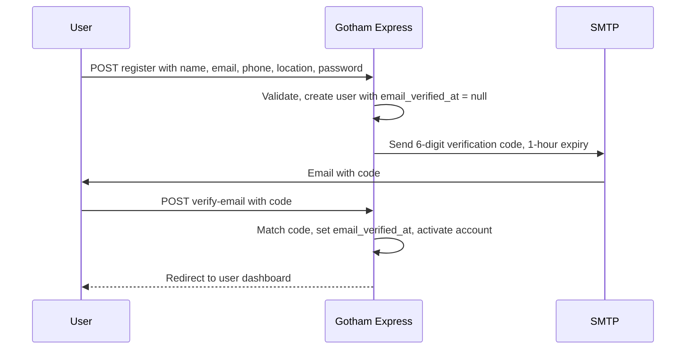
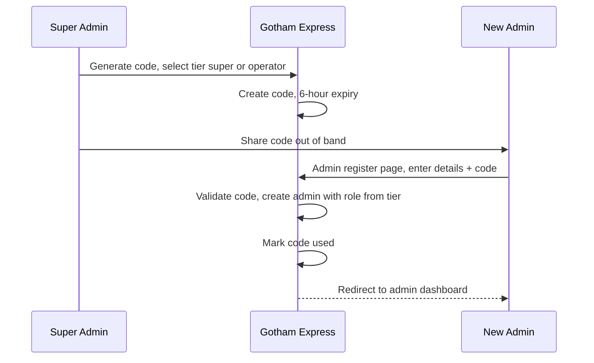
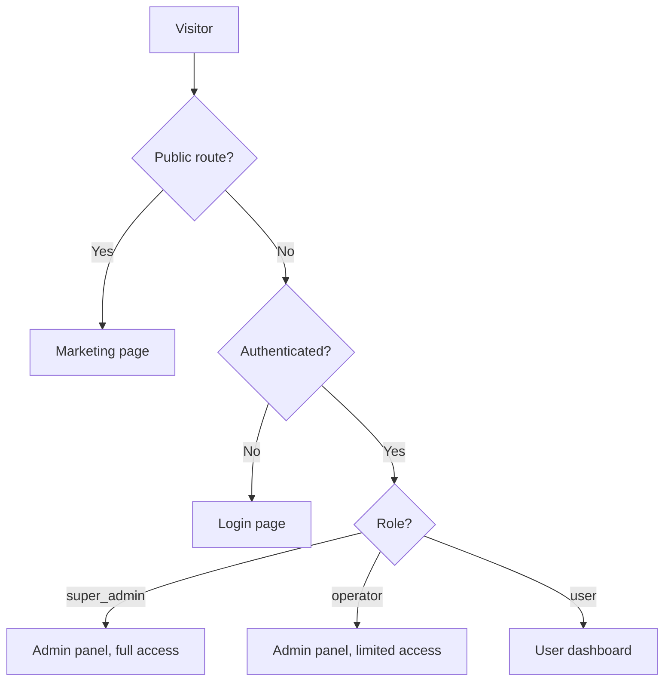
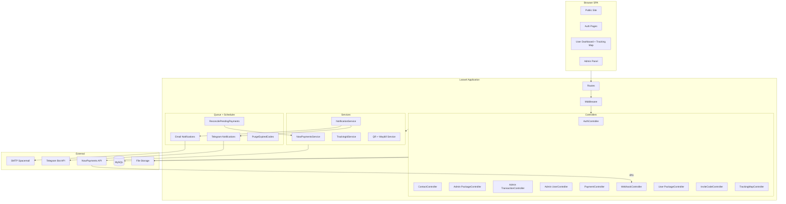
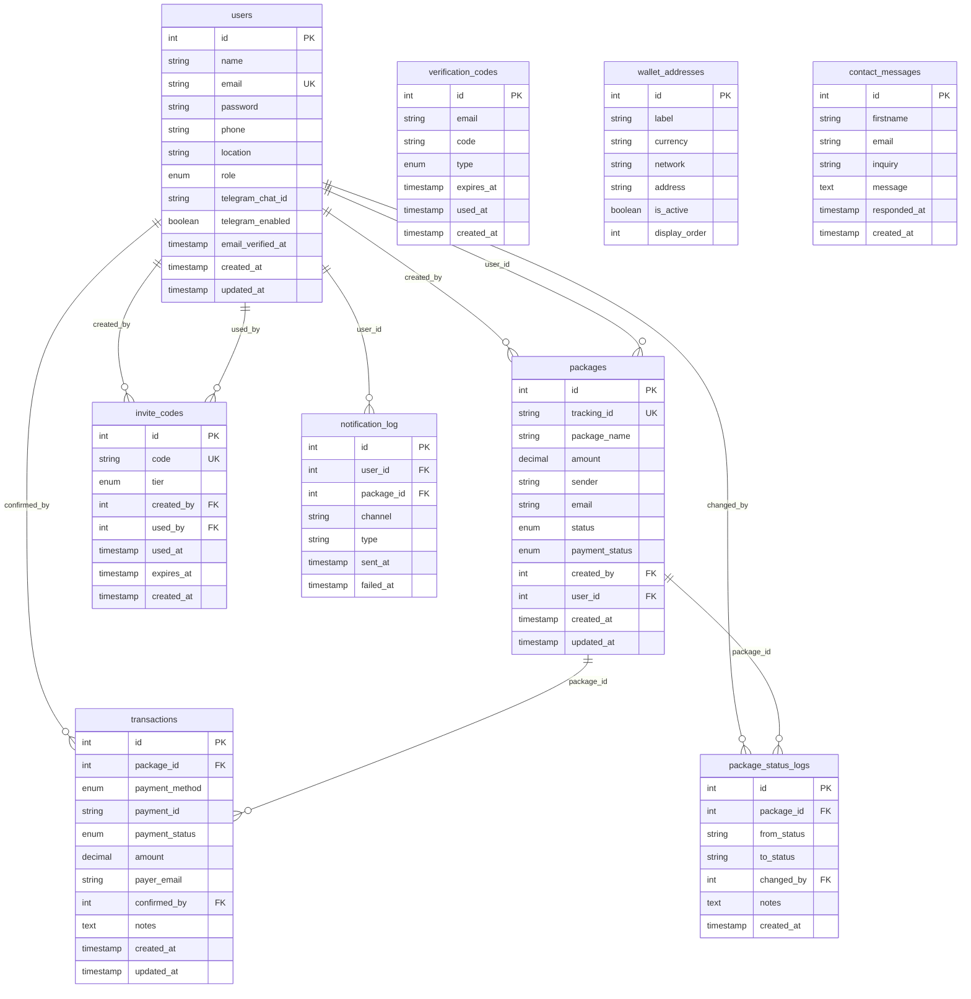

# Gotham Express — Project Plan v3 (Final)

> All decisions cemented. All questions answered. This is the build spec.

---

## 1. What Gotham Express Is

A consignment and parcel tracking platform. An admin creates packages for recipients, each gets a unique GTX-prefixed tracking ID, and the recipient logs into their account to view package status on a visual world-map tracking interface, manage payments, and view history. Payments are either automated (NowPayments crypto) or manual (admin posts wallet addresses, recipient sends crypto externally, admin confirms receipt). The platform replaces a procedural PHP codebase (TruePath Express) with a Laravel + Inertia (React) rebuild under the Gotham Express brand.

**Domain:** gotham.mgbah.dev

---

## 2. Audiences and Roles

| Role | How they get in | What they do |
|---|---|---|
| **Super Admin** | Invite code (super tier). Can generate codes for both super and sub admins. | Full system access. Package CRUD, status management, payment confirmation, user management, admin management, invite codes, wallet addresses, audit logs, system settings. |
| **Sub Admin / Operator** | Invite code (operator tier). | Package CRUD, status management, payment confirmation, view transactions. Cannot manage admins, generate invite codes, access settings, or view audit logs. |
| **User** | Self-registration. Email + phone + location + password, verified by 6-digit email code. | Views own packages on visual tracking dashboard, views payment history, copies wallet addresses to pay, manages profile, opt-in/out of Telegram. |

No guest tracking. Public site is marketing + contact + auth only.

---

## 3. Auth System

### 3.1 User registration



### 3.2 Admin creation via invite codes

Invite codes are alphanumeric, single-use, expire 6 hours after generation. Super admins generate them from the panel for either tier.



### 3.3 Password reset

6-digit code to email, 15-minute expiry. Max 5 attempts per code.

### 3.4 Auth routing



---

## 4. System Architecture

### 4.1 Stack

| Layer | Technology |
|---|---|
| Backend | Laravel 11+ |
| Frontend | React via Inertia.js |
| Build | Vite |
| Database | MySQL 8+ |
| Queue | Database driver |
| Email | SMTP via Laravel Mail (spacemail default) |
| Notifications | Laravel Notification classes, email + Telegram |
| Automated payments | NowPayments API |
| Manual payments | Admin wallet addresses + manual confirmation |
| File storage | Laravel filesystem with storage link |
| PDF generation | DomPDF for waybills and receipts |
| QR codes | SimpleSoftwareIO/simple-qrcode |
| Maps | React Simple Maps or Leaflet for tracking visualization |
| Deploy | Hetzner VPS via Coolify |

### 4.2 Architecture diagram



---

## 5. Design System

### 5.1 Color palette

| Token | Name | Hex | Usage |
|---|---|---|---|
| --color-black | Pure Black | #000000 | Primary text, headings, dark backgrounds, admin sidebar |
| --color-blue | Cobalt Blue | #3478F7 | Primary accent, links, active states, primary buttons, map routes |
| --color-orange | Tangerine | #EC562E | Secondary accent, CTAs, warnings, status highlights, hover states |
| --color-peach | Petal Peach | #F3D2C6 | Soft backgrounds, card fills, alt sections, subtle highlights |
| --color-white | White | #FFFFFF | Page backgrounds, card surfaces, input backgrounds |
| --color-gray-50 | -- | #FAFAFA | Subtle alt backgrounds |
| --color-gray-100 | -- | #F5F5F5 | Input borders, dividers |
| --color-gray-200 | -- | #E5E5E5 | Borders, separators |
| --color-gray-400 | -- | #A3A3A3 | Placeholder text, muted labels |
| --color-gray-600 | -- | #525252 | Secondary text |
| --color-gray-800 | -- | #262626 | Body text in dark mode |
| --color-success | -- | #16A34A | Confirmed, delivered, paid badges |
| --color-error | -- | #DC2626 | Failed, cancelled, error states |
| --color-warning | -- | #F59E0B | Pending, processing states |
| --color-info | -- | #3478F7 | Info badges, same as blue |

### 5.2 Dark mode

In scope. Implementation:

- CSS custom properties for all colours, redefined under `[data-theme="dark"]` on the root element.
- Theme toggle in the user/admin sidebar or header.
- Preference stored in `localStorage` and respected on load.
- Dark mode inverts surfaces (black/dark gray backgrounds, white text), keeps the accent colours (Cobalt Blue, Tangerine) vibrant, and shifts Petal Peach to a muted warm tone.
- All components must support both modes via CSS variables only. No inline colour values anywhere.

### 5.3 Typography

| Token | Value | Usage |
|---|---|---|
| --font-family | Coolvetica, system-ui, sans-serif | All text (carry forward from existing brand) |
| --font-size-xs | 0.75rem | Captions, timestamps |
| --font-size-sm | 0.875rem | Secondary text, table cells |
| --font-size-base | 1rem | Body text |
| --font-size-lg | 1.125rem | Subheadings |
| --font-size-xl | 1.25rem | Section titles |
| --font-size-2xl | 1.5rem | Page titles |
| --font-size-3xl | 2rem | Hero subtitle |
| --font-size-4xl | 3rem | Hero title |

### 5.4 Design direction

Based on the reference images:

- **Card-based layouts** with generous padding, rounded corners (8-12px radius), subtle shadows.
- **Whitespace-heavy** — let elements breathe. No cramming.
- **Clean invoice aesthetic** for waybills and receipts — large bold headers, aligned columns, clear hierarchy.
- **Minimal icons** — functional, not decorative. Phosphor Icons bold face.
- **Responsive** — four breakpoints: 576px, 768px, 992px, 1200px.

---

## 6. Data Model

All tables from v2 carry forward unchanged. One addition:

**users table** — add `telegram_enabled` boolean, default false. Controls whether Telegram notifications are sent (email is always on, not optional).

All other tables (invite_codes, verification_codes, packages, transactions, wallet_addresses, package_status_logs, notification_log, contact_messages) remain as specified in v2 Section 5.1.

### 6.1 ER diagram



---

## 7. Payment System

Unchanged from v2 Section 6. Two modes: automated NowPayments crypto and manual crypto (admin posts wallet addresses, user sees all active addresses, copies, pays externally, admin confirms).

---

## 8. Shipment Lifecycle

Unchanged from v2 Section 7. Four statuses: processing, in_transit, delivered (terminal), cancelled (terminal). Backward transitions blocked from terminal states. Every transition logged.

### 8.1 QR codes

Each package gets a QR code encoding a URL: `https://gotham.mgbah.dev/track/{tracking_id}`. If the scanner is not authenticated, they are redirected to the login page. After login, they land on the package detail view.

### 8.2 Waybill / Invoice Receipt PDF

Based on the invoice reference image. Clean, minimal document layout:

```
+--------------------------------------------------+
|                                                    |
|  GOTHAM EXPRESS              WAYBILL               |
|  gotham.mgbah.dev            #{tracking_id}        |
|                                                    |
|  From                        To                    |
|  {sender}                    {firstname} {lastname} |
|                              {address}              |
|                              {location}             |
|                              {phone}                |
|                              {email}                |
|                                                    |
+--------------------------------------------------+
|                                                    |
|  Package Details                                   |
|                                                    |
|  Package Name          {package_name}              |
|  Description           {description}               |
|  Address Type          {address_type}              |
|  Status                {status}                    |
|  Payment Status        {payment_status}            |
|                                                    |
|                    Amount     ${amount} USD         |
|                                                    |
+--------------------------------------------------+
|                                                    |
|  [QR CODE]          Created    {created_at}        |
|                     Tracking   {tracking_id}       |
|                                                    |
|  Terms                                             |
|  This waybill is a receipt of consignment.         |
|  Contact support@gotham.mgbah.dev for inquiries.   |
|                                                    |
+--------------------------------------------------+
```

Generated via DomPDF. Clean typography, no decorative elements. Same design system colours. Downloadable from admin package detail page.

---

## 9. Notification System

### 9.1 Channels

| Channel | Transport | Opt-out |
|---|---|---|
| Email | SMTP via Laravel Mail, queued | Always on, not optional |
| Telegram | Bot API, @GothamExpressBot | User can opt in/out from profile |

Telegram notifications only sent when `telegram_enabled = true` AND `telegram_chat_id` is set on the user record.

### 9.2 Email templates

Redesigned with the new design system. Branded wrapper using the Gotham Express colour palette (Pure Black header bar, Cobalt Blue accents, Petal Peach footer). Logo from gotham.mgbah.dev. All templates share one layout.

### 9.3 Auto-link notification

When admin creates a package with a recipient email that matches a registered user, the package is auto-linked (`user_id` set). The user receives a notification: "Your package {tracking_id} has been set for delivery. View your dashboard to track and make payment."

---

## 10. Frontend Architecture

### 10.1 Page map

```
resources/js/
├── app.jsx
├── Layouts/
│   ├── PublicLayout.jsx
│   ├── AuthLayout.jsx
│   ├── AdminLayout.jsx
│   └── UserLayout.jsx
│
├── Pages/
│   ├── Public/
│   │   ├── Home.jsx
│   │   ├── About.jsx
│   │   ├── Services.jsx
│   │   ├── Contact.jsx
│   │   ├── Policy.jsx
│   │   └── Terms.jsx
│   │
│   ├── Auth/
│   │   ├── Login.jsx
│   │   ├── Register.jsx
│   │   ├── VerifyEmail.jsx
│   │   ├── ForgotPassword.jsx
│   │   ├── VerifyResetCode.jsx
│   │   └── ResetPassword.jsx
│   │
│   ├── Admin/
│   │   ├── Dashboard.jsx
│   │   ├── Packages/
│   │   │   ├── Index.jsx
│   │   │   ├── Create.jsx
│   │   │   ├── Edit.jsx
│   │   │   └── Show.jsx
│   │   ├── Transactions/
│   │   │   └── Index.jsx
│   │   ├── Users/
│   │   │   ├── Index.jsx
│   │   │   └── Show.jsx
│   │   ├── Payments/
│   │   │   └── ConfirmPayment.jsx
│   │   ├── InviteCodes/
│   │   │   └── Index.jsx
│   │   ├── AuditLog/
│   │   │   └── Index.jsx
│   │   └── Settings/
│   │       ├── WalletAddresses.jsx
│   │       └── General.jsx
│   │
│   └── User/
│       ├── Dashboard.jsx              Overview with summary cards
│       ├── Tracking.jsx               WORLD MAP tracking interface
│       ├── Packages/
│       │   ├── Index.jsx              All my packages list
│       │   └── Show.jsx               Single package detail + timeline + payment
│       ├── Payments/
│       │   └── Index.jsx              Payment history
│       └── Profile/
│           └── Edit.jsx               Name, email, phone, location, Telegram toggle
```

### 10.2 User tracking page (Tracking.jsx)

This is the centerpiece of the user experience. A full visual tracking interface.

**Layout:**

```
+----------------------------------------------------------------+
|  [Sidebar]  |  TRACKING                                        |
|             |                                                    |
|  Dashboard  |  +--------------------------------------------+   |
|  Tracking   |  |                                            |   |
|  Packages   |  |         WORLD MAP                          |   |
|  Payments   |  |                                            |   |
|  Profile    |  |    [Origin Pin] -----> [Destination Pin]   |   |
|             |  |         plane/ship icon on route line      |   |
|             |  |                                            |   |
|             |  +--------------------------------------------+   |
|             |                                                    |
|             |  +------------------+  +---------------------+    |
|             |  | Active Package   |  | Status Timeline     |    |
|             |  | GTX-7A3F9B2C     |  | * Processing  [done]|    |
|             |  | Sender: Wayne    |  | * Shipped    [active]|   |
|             |  | Amount: $450     |  | * Delivered  [next]  |    |
|             |  | Status: Shipped  |  |                     |    |
|             |  +------------------+  +---------------------+    |
|             |                                                    |
|             |  Package selector (if user has multiple packages) |
+----------------------------------------------------------------+
```

**Components:**

- **WorldMap** — SVG world map (react-simple-maps) showing origin and destination markers connected by a curved route line. An animated icon (plane for air freight, ship for sea) moves along the route based on status (at origin for processing, mid-route for in_transit, at destination for delivered).
- **PackageSelector** — dropdown or horizontal scroll of package cards if the user has multiple active packages. Selecting one updates the map and timeline.
- **StatusTimeline** — vertical stepper showing all status transitions from package_status_logs with timestamps and notes.
- **ActivePackageCard** — summary card with tracking ID, sender, amount, status badge, payment status badge.
- **PaymentSection** — if unpaid, shows wallet addresses with copy buttons + NowPayments button. If paid, shows confirmation details.

**Data flow:** The page receives all user packages as Inertia props. Selecting a package swaps the displayed data client-side. Polling (usePolling) refreshes the package data every 30 seconds for live status updates.

### 10.3 UX component library

**Core UI primitives:**

| Component | Purpose |
|---|---|
| Button | Primary, secondary, outline, ghost, danger variants. Loading spinner state. Sizes: sm, md, lg. |
| FormInput | Text input with label, helper text, error message, required indicator. Wraps Inertia useForm. |
| FormSelect | Dropdown select with same wrapper pattern. |
| FormTextarea | Multiline input with character count option. |
| CodeInput | 6-digit verification code input. Auto-focus next, paste support, error state. |
| Badge | Status badges with colour variants mapped to status values. Dot indicator option. |
| Toast | Global notification system. success, error, info, warning. Auto-dismiss timer. Stacked. useToast hook. |
| Modal | Centered on desktop, slide-up on mobile. Sizes: sm, md, lg, full. Header, body, footer slots. |
| ConfirmDialog | Modal variant for destructive actions. Title, message, confirm/cancel buttons. useConfirm hook. |
| Loader | Page transition bar, section skeleton, inline spinner. Three modes. |
| EmptyState | Illustration + message + action button for empty lists. |

**Data display:**

| Component | Purpose |
|---|---|
| DataTable | Sortable columns, search, filters, row actions, bulk selection, pagination. Responsive (card view on mobile). |
| Pagination | Page numbers + prev/next. Works with Laravel paginator. |
| StatCard | Metric card with icon, value, label, trend indicator. Accent colour variants. |
| Card | Generic content card with header, body, footer slots. Bordered and elevated variants. |
| Timeline | Vertical timeline with dots, connectors, timestamps. Active/completed/pending states. |
| StatusTracker | Horizontal 3-step tracker (Processing > Shipped > Delivered) with animated progress. |
| TransactionRow | Table row component for transaction lists with status badge, amount, date. |
| PackageCard | Summary card with tracking ID, recipient, status, payment status, quick actions. |
| WalletAddressCard | Wallet address display with currency icon, network label, address string, copy button. |
| Avatar | User initials or image. Sizes: xs, sm, md, lg. |
| Tag | Small label chip for categories, filters. Removable variant. |

**Navigation and layout:**

| Component | Purpose |
|---|---|
| Sidebar | Collapsible sidebar with nav items, active state, section dividers, user info at bottom. |
| SidebarItem | Nav link with icon, label, badge count (for notifications). Active state highlight. |
| Header | Top bar with page title, breadcrumbs, user menu dropdown, notification bell, theme toggle. |
| Breadcrumb | Path trail with links. Auto-generated from route. |
| Tabs | Horizontal tab bar for switching views within a page. |
| MobileNav | Bottom navigation bar on mobile with icon + label for main sections. |
| ThemeToggle | Dark/light mode switch. Sun/moon icon. Persists to localStorage. |

**Feedback and interaction:**

| Component | Purpose |
|---|---|
| Tooltip | Hover tooltip for truncated text, icon buttons, info hints. |
| Alert | Banner alert for page-level messages. Info, warning, error, success. Dismissible. |
| Progress | Linear progress bar for file uploads, multi-step forms. |
| Dropdown | Click-triggered dropdown menu for actions. Used in table rows, user menu. |
| CopyButton | Click to copy text to clipboard. Visual feedback (checkmark replaces copy icon for 2s). |
| FileUpload | Drag-and-drop zone with preview. Image preview for package images. Size/type validation. |
| SearchBar | Input with search icon, debounced (useDebounce), clear button. Used in DataTable header. |
| DatePicker | Date selection for filters. Range mode for transaction date filtering. |
| AmountDisplay | Formatted currency display ($450.00 USD) with consistent styling. |
| QRDisplay | Renders QR code inline with download button. |

**Map and tracking:**

| Component | Purpose |
|---|---|
| WorldMap | SVG world map with zoom/pan. Renders origin and destination markers, curved route line, animated transport icon. |
| MapMarker | Pin component for origin/destination on the map. Label tooltip on hover. |
| RouteAnimation | Animated icon (plane/ship) that moves along the route line based on package status percentage. |
| PackageSelector | Horizontal scroll or dropdown for selecting which package to track when user has multiple. |

### 10.4 Hooks

| Hook | Purpose |
|---|---|
| useToast | Dispatch toast notifications from anywhere. Returns { success, error, info, warning } methods. |
| usePolling | Wraps Inertia router.reload with interval and only param. Start/stop controls. |
| useConfirm | Opens ConfirmDialog, returns a promise that resolves on confirm/cancel. |
| useDebounce | Debounce a value by N ms. Used in search inputs. |
| useTheme | Read/set dark/light theme. Syncs to localStorage and data-theme attribute. |
| useClipboard | Copy text to clipboard, returns copied state with auto-reset timer. |
| usePagination | Track current page, per-page, sync with Inertia URL params. |
| useFilters | Manage filter state for DataTable, sync with URL query params via Inertia. |

---

## 11. Security

Unchanged from v2 Section 10. All items in scope, non-negotiable.

---

## 12. Background Jobs

Unchanged from v2 Section 11.

---

## 13. Route Map

### 13.1 Public routes

| Method | URI | Controller |
|---|---|---|
| GET | / | PublicController@home |
| GET | /about | PublicController@about |
| GET | /services | PublicController@services |
| GET | /contact | ContactController@create |
| POST | /contact | ContactController@store |
| GET | /policy | PublicController@policy |
| GET | /terms | PublicController@terms |
| GET | /track/{tracking_id} | QR redirect, auth gate, then package detail |

### 13.2 Auth routes

| Method | URI | Controller |
|---|---|---|
| GET/POST | /login | Auth LoginController |
| GET/POST | /register | Auth RegisterController |
| GET/POST | /verify-email | Auth VerifyEmailController |
| GET/POST | /forgot-password | Auth ForgotPasswordController |
| GET/POST | /verify-reset-code | Auth VerifyResetCodeController |
| GET/POST | /reset-password | Auth ResetPasswordController |
| POST | /logout | Auth LoginController@destroy |
| GET/POST | /admin/register | Admin AdminRegisterController (requires invite code) |

### 13.3 Admin routes (auth + role gate)

| Method | URI | Controller | Access |
|---|---|---|---|
| GET | /admin/dashboard | Admin DashboardController@index | All admins |
| Resource | /admin/packages | Admin PackageController | All admins |
| POST | /admin/packages/{id}/confirm-payment | Admin PaymentController@store | All admins |
| GET | /admin/packages/{id}/waybill | Admin WaybillController@show | All admins |
| GET | /admin/transactions | Admin TransactionController@index | All admins |
| Resource | /admin/users | Admin UserController | Super only |
| Resource | /admin/invite-codes | Admin InviteCodeController | Super only |
| GET | /admin/audit-log | Admin AuditLogController@index | Super only |
| Resource | /admin/settings/wallets | Admin WalletController | Super only |
| GET | /admin/settings | Admin SettingsController@index | Super only |

### 13.4 User routes (auth + role:user)

| Method | URI | Controller |
|---|---|---|
| GET | /dashboard | User DashboardController@index |
| GET | /dashboard/tracking | User TrackingController@index |
| GET | /dashboard/packages | User PackageController@index |
| GET | /dashboard/packages/{id} | User PackageController@show |
| POST | /dashboard/packages/{id}/pay | User PaymentController@createInvoice |
| GET | /dashboard/payments | User PaymentController@index |
| GET | /dashboard/profile | User ProfileController@edit |
| PUT | /dashboard/profile | User ProfileController@update |
| POST | /dashboard/profile/link-telegram | User ProfileController@linkTelegram |
| PUT | /dashboard/profile/telegram-toggle | User ProfileController@toggleTelegram |

### 13.5 Webhook routes (no CSRF)

| Method | URI | Controller |
|---|---|---|
| POST | /webhooks/nowpayments | Webhook NowPaymentsController@handle |
| POST | /webhooks/telegram | Webhook TelegramController@handle |

---

## 14. What Is NOT in Scope

| Feature | Status |
|---|---|
| Driver / dispatcher roles | Not needed |
| Guest tracking | Removed, user dashboard only |
| Pricing engine / rate card | Admin sets price manually |
| Live GPS tracking | World map with milestone-based visualization instead |
| Multi-currency | USD only |
| SMS notifications | Not requested |
| WhatsApp notifications | Not requested |
| Fiat payment methods | Crypto only |
| Testimonials carousel | Dropped |
| Bulk CSV import/export | Not in v1 |

---

## 15. Resolved Decisions

All previously open questions, now cemented:

| # | Decision | Answer |
|---|---|---|
| 1 | Sub-admin permissions | As scoped in permission matrix. Can CRUD packages, confirm payments, view transactions. Cannot manage admins, generate invites, access settings, view audit. |
| 2 | Invite code format | Alphanumeric, 6-hour expiry. Super admin generates for both super and sub tiers. |
| 3 | Wallet address display | User sees all active addresses. Global config, not per-package. |
| 4 | Package auto-linking | Auto-link by email match. Notification sent on link. |
| 5 | Telegram bot | @GothamExpressBot |
| 6 | Domain | gotham.mgbah.dev |
| 7 | QR code target | Redirect to login if not authenticated, then to package detail. |
| 8 | Waybill content | Invoice-receipt style with sender, recipient, address, tracking ID, QR, package details, amount. See Section 8.2. |
| 9 | Email templates | Redesign with new design system (black/blue/peach palette). |
| 10 | Notification preferences | Email always on. Telegram opt-in/out via profile toggle. |
| 11 | Dark mode | In scope. CSS variable based with theme toggle. |
